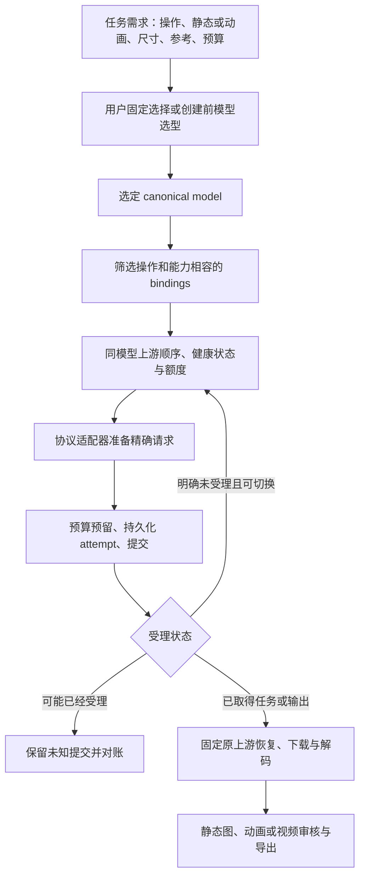

# VideoCreate：多模型、多上游与 GIF 完整开发清单

日期：2026-11-07（Asia/Shanghai）

审计基线：`3.0.0.dev2`，包括当前工作区已有未提交修改。

交付性质：保留原始完整路线图，并按 dev3 更新已完成项。未勾选项为尚未完整验收；实际代码与账户测试范围见 [dev3 交付记录](20261107-model-routing-gif-acceptance.zh-CN.md)。

## 1. 建议先确定的结论

1. 将 `gpt-image-2.6`、`gpt-image-2.6-flare`、`gpt-image-2.6-sunburst` 全部登记为独立可选模型；保留 `gpt-image-2.5`。将 `grok-imagine-image-2.0` 放在独立的 Grok 图片系列。
2. 新配置以普通 `gpt-image-2.6` 为默认候选，完成对应上游的生成/编辑合同检查后启用。这里的选择依据是用户要求升级及采用基础型号，不是已经证明它画质最好。现有项目和现有有效默认配置通过显式迁移升级，运行中任务保持原始快照。
3. 支持“按需求选模型”和“同模型换上游”两个独立步骤。前者发生在创建任务前，后者解决服务故障；不要合并成一个无限重试开关。
4. 初期不要把 `flare` 写成快速版、把 `sunburst` 写成高质量版。当前读取的目录没有这些说明，未取得可核实的官方型号说明及参数文档。先配置，后验证，再给予用途标签和自动选择资格。
5. GIF 是可以承载动画的图片格式，也可以只有一帧。接收 GIF、原生生成动画 GIF、从视频导出 GIF、将 GIF 作为模型输入，是四种不同能力，分别实现与验证。
6. 视频优先完善同模型多上游切换，随后复用到图片。保留“未知提交不重发”和“已知任务固定原上游”的现有设计，防止一个超时触发多次计费。
7. 延续已有 `models / upstreams / bindings / routes`，补齐能力、选型和故障处理，不推倒现有项目、预算、回执和恢复机制。

## 2. 本次核实了什么

### 2.1 只读目录结果

本次通过本机已有凭据只读访问模型目录，没有调用生成、编辑、上传或付费探测接口。目录结果只能证明相应账户能看到这些 ID。

| 来源 | 观察 | 不能据此认定 |
|---|---|---|
| Aivalux，现有 GPT 图片账户，`GET /v1/models` | 出现 `gpt-image-2.5`、三个 `gpt-image-2.6` 型号；还出现其他旧型号 | 三个新型号的画质、速度、价格、GIF 能力或参数相同 |
| Aivalux，现有 Grok 账户，`GET /v1/models` | 出现 `grok-imagine-image-2.0`、`grok-imagine-video-1.5`、`muse-video` | Muse 与 Grok 1.5 是同一个实际模型；所有参考/音频能力可互换 |
| RapidAPI，现有本机账户，`GET /v1/models` | 出现 `grok-imagine-video-1.5`；此次没有看到 `muse-video` | 所有账户都不支持 Muse，或用户新提供的账户具有相同目录 |
| GateAI | 本次访问了公开站点；四个 GPT 型号来自用户提供的接入清单 | 当前账户已验证可生成，或与 Aivalux 使用完全相同的请求协议 |
| OpenAI 官方文档 | 请求型号页及图片指南时返回 HTTP 403 | 型号不存在，或第三方目录中的 `owned_by` 已证明官方来源 |

第三方目录将三个 GPT 型号的 `owned_by` 写为 `openai`，将 Muse 的 `owned_by` 写为 `xai`。这只是目录返回的标签，不足以证明厂商身份、别名对应或功能差异。

审计结果摘要见 [只读证据](design/20261107-model-catalog-audit.json)。公开入口：[Aivalux](https://www.aivalux.com/)、[GateAI](https://gateai.cc/)、[RapidAPI](https://rapidapi.cc/)。尝试核验但本次不可读取的官方入口：[Image generation](https://developers.openai.com/api/docs/guides/image-generation)、[GPT Image 2.6](https://developers.openai.com/api/docs/models/gpt-image-2.6)。这些受阻页面不作为能力结论来源。

### 2.2 三个 GPT 型号的推荐定位

| 精确模型 ID | 当前证据 | 首期配置角色 | 以后如何自动使用 |
|---|---|---|---|
| `gpt-image-2.6` | Aivalux 目录可见；能力未实测 | 常规静态生成/编辑的默认候选 | 对支持的操作、尺寸和参考方式完成验证后，作为通用候选 |
| `gpt-image-2.6-flare` | Aivalux 目录可见；差异未知 | 保留独立型号，可显式指定 | 若实测延迟/费用有优势且质量合格，再进入快速草图策略；若优势不同则按实测分配 |
| `gpt-image-2.6-sunburst` | Aivalux 目录可见；差异未知 | 保留独立型号，可显式指定 | 若实测文字、细节、编辑或动画表现更好，再进入相应策略 |
| `gpt-image-2.5` | 当前本机默认；目录可见 | 兼容旧项目及可显式选择的旧型号 | 仅在新任务选型规则允许时作为成本/兼容候选；不默默替换明确要求的 2.6 |
| `grok-imagine-image-2.0` | Aivalux Grok 账户目录可见 | 独立图片模型、独立能力合同 | 按实测的风格、参考忠实度、速度与成本参与选型；缺少第二上游时如实报告无备用 |

同名模型在两个中转站的能力也可能不同；默认静态图为 PNG。GIF 请求只有在对应 binding 验证动画输出后才可走原生路径。

## 3. 当前代码的实际能力与缺口

| 部分 | 已有实现 | 本轮需要补齐 | 代码位置 |
|---|---|---|---|
| 配置结构 | 模型有 kind/family；上游含 URL/auth；binding 选精确远端名和 adapter；route 选同模型候选 | 按家族展示、操作级能力、选型策略和更明确的证据来源 | `src/videocreate/config/schema.py`、`catalog/bindings.py` |
| 视频备用 | `automatic-same-model` 在配置确认的 HTTP rejection 后切下一候选；显式 binding 固定 | 请求前全候选能力过滤、故障分类、共享健康状态、退避、可解释决策 | `runtime/jobs.py`、`adapters/video.py` |
| 图片备用 | 配置能列多个候选，但 `generate_image()` 只取 `route_bindings(...)[0]` | 图片完整故障转移和恢复；批量路径不能提前把自动路由锁成固定 binding | `assets.py:46`、`assets.py:141` |
| 图片异常 | 保存失败响应并支持恢复/重新解码；无响应异常通常记为 `submission_unknown` | 区分明确拒绝、确实未发出、可能已提交、下载失败、解码失败 | `assets.py:115`、`assets.py:236` |
| 图片协议 | 生成 JSON、编辑 multipart；固定发送 PNG、b64_json、size、quality、n=1 | 每个 binding 声明可接受参数；支持其他格式、返回方式、异步/流式协议时另设适配器 | `adapters/image.py:40` |
| GIF 文件 | `image_extension()` 只识别 PNG/JPEG/WebP；参考注册拒绝 GIF | GIF 解码、帧/时长/循环元数据、输入策略、动态审核和导出 | `scripts/vc_common.py:706`、`assets.py:22` |
| 需求选型 | `routing.recommend()` 对已选模型的 bindings 给能力/质量建议 | 跨型号的创建前选型、指标与解释；保持用户明确选择优先 | `routing.py:43` |
| 能力证据 | 现有 catalog/contract/smoke/quality 回执和指纹 | 对操作、参数组合、动画输出分别记录证据；过期及配置变动失效 | `catalog/evidence.py` |
| 任务恢复 | 提交前持久化；task ID、binding 快照、未知提交对账和预算 | 将图片/视频统一到相同的尝试记录和恢复语义，兼容旧记录 | `runtime/jobs.py`、`runtime/reconcile.py`、`runtime/budget.py` |
| 并发 | 全局图片/视频任务池与本机 upstream 提交槽 | 同账户不同别名共享额度；提交速率、远端在途任务与轮询配额分开 | `runtime/limits.py` |
| 旧兼容层 | v3 仍调用部分 `scripts/media_client.py`；旧图片 bridge 投影一个默认 binding | 新能力统一由 v3 路由驱动，旧入口保留兼容，避免两套策略分叉 | `config/bridge.py`、`scripts/media_client.py` |

路径均相对 `videocreate/`。当前 GIF 不是“只把输出后缀改掉”就能接入。

本机配置的真实状态也需计入迁移：

- 默认图片是 `gpt-image-2.5`，只有 `image-primary`。
- Grok 视频默认是固定的 `grok-imagine-video-1.5--rapidapi-json`；虽列有其他候选，固定模式不会切换。
- `rapidapi` 实例的 platform 标为 `newapi`，同时有 Sub2API JSON 和 NewAPI JSON binding。用户此次描述为 Sub2API；保留已有可用路径，逐条核验 endpoint/body/query 合同，不按域名或标签批量改协议。
- `muse-video` 当前是独立 canonical model，family 为 `muse`；本机声明 10 秒上限、1 主图 + 6 引导图。声明不等于本次实测。
- Seedance 已有配置条目，但本次未核验生成能力；不能把“有条目”当作“已接入验收”。

## 4. 目标分层

用户看到的第一层是模型家族；代码保持规范化索引，避免把同一个账户复制到每个型号下。

```text
模型家族
├─ GPT Image
│  └─ 图片 → 2.6 / 2.6-flare / 2.6-sunburst / 2.5
│     └─ 生成/编辑/已验证的动画操作
│        └─ 上游平台 → 账户实例 → 精确模型与协议绑定
├─ Grok
│  ├─ 图片 → grok-imagine-image-2.0
│  └─ 视频 → grok-imagine-video-1.5
├─ Muse（沿用当前独立家族；实际归属与等价关系待核实）
│  └─ 视频 → muse-video
└─ Seedance
   └─ 视频 → 未来实际供应的精确型号
```

GIF 属于输出与动画能力，不单独制造一个“GIF 厂商/模型家族”。可在用户界面上把 Grok 与 Muse 视频并排显示，数据层仍保留不同身份。



六类对象的职责：

| 对象 | 保存内容 | 关键约束 |
|---|---|---|
| 模型 `models` | kind、family、展示名、内部稳定 ID、提示策略 | 模型 ID 不代表接口协议；不同型号默认不等价 |
| 上游 `upstreams` | 服务地址、平台标签、凭据引用、网络与账户额度 | 同域名不同账户可不同实例；相同账户共享并发/健康额度 |
| 绑定 `bindings` | canonical model + upstream + 精确 remote_model + adapter + 操作能力与价格 | 同上游不同模型可用不同协议；必要时一个操作一个 binding |
| 选型 `selection_policies`（拟新增） | 需求硬条件、允许模型集合、质量门槛、成本/延迟偏好 | 只影响新任务；用户指定精确模型时禁止覆盖 |
| 路由 `routes` | 同模型候选、优先顺序、固定/自动、切换条件与尝试上限 | 先过滤能力，再排顺序；不静默丢参考、降时长、降分辨率 |
| 运行记录 `jobs/attempts` | 原始需求、模型选择、路由原因、提交证据、绑定快照、输出和费用 | 恢复时不重新选模；不同创建尝试分别记账 |

配置 schema 升级建议：现有结构映射先用 schema 3；新增严格字段和行为时发布配置 schema 4，并实现 v3→v4 无损迁移。软件版本、配置 schema、项目 schema、adapter 版本分别管理；本轮不因此要求所有旧项目升级。

## 5. 用户给定服务的接线方案

| 模型组 | 主实例候选 | 备实例候选 | 账户/协议说明 |
|---|---|---|---|
| 四个 GPT 图片型号，各自独立路由 | `aivalux-gpt` | `gateai-gpt` | Aivalux 图片密钥与其 Grok 密钥分开；Images 协议逐站验证 |
| Grok Image 2.0 | `aivalux-grok` | 暂无 | 复用 Aivalux Grok 账户；仍是独立图片 binding |
| Grok Video 1.5 | `aivalux-grok` | `rapidapi-grok`，以及原有经验证 NewAPI binding | 主备顺序是新增配置建议，不覆盖现有运行中任务与固定默认 |
| Muse Video | `aivalux-grok` | `rapidapi-grok` 待确认 | RapidAPI 的 Muse 候选在账户目录与合同检查前保持禁用 |
| Seedance | 后续实际供应的上游 | 后续实际供应的其他上游 | 获取精确型号、鉴权、接口和能力后登记；不用 Grok 限制直接套用 |

建议账户引用名：`VIDEOCREATE_AIVALUX_GPT_API_KEY`、`VIDEOCREATE_GATEAI_GPT_API_KEY`、`VIDEOCREATE_AIVALUX_GROK_API_KEY`、`VIDEOCREATE_RAPIDAPI_GROK_API_KEY`。实际本机可以继续使用已有 DPAPI `secret_ref`，不用把密钥放入仓库或项目。

“平台”只是分类，不能决定 HTTP 协议。Sub2API 视频、NewAPI JSON 视频、NewAPI multipart 视频、Images API 必须分别保留适配器。若 Grok 图片接口并不接受 GPT 的 quality/size/response_format 等字段，就按真实合同增加映射或独立适配器，不先发送后靠失败猜参数。

无密钥的完整接线示例见 [schema 3 配置草案](design/20261107-model-upstreams.config.draft.json)。该文件仅展示模型和绑定关系，所有 binding 禁用，不覆盖本机配置，不含尚未实现的 GIF/选型字段；不能把它当作最终可运行配置。

## 6. 自动选择模型的规则

选择顺序为：显式模型/binding约束 → 操作与输出硬条件 → 参考/尺寸/声音等硬条件 → 已验证质量门槛 → 预算 → 可用性 → 延迟/费用偏好 → 稳定顺序。

拟提供的需求策略：

| 用户需求 | 硬条件 | 候选的来源 |
|---|---|---|
| 普通图片、视频首帧 | 静态图、目标尺寸、构图和人物要求 | 默认候选 2.6；通过验证后可纳入其他明确允许的型号 |
| 快速草图 | 满足最低质量且更低延迟/成本 | 实测结果，不能从 flare 名称推导 |
| 海报与中文文字 | 文字正确率、布局、分辨率 | 实测通过的型号/绑定；不是纯 aesthetic 分数 |
| 多参考编辑 | 支持编辑、多参考数量与角色/产品保真 | 合同与样片；不自动删到只剩一张参考 |
| 循环动图 | 输出多帧、时长、循环、帧率和体积 | 原生动画 binding；无可用原生路径时采用已选定的替代工作流 |
| 视频对白或复杂参考 | 原生音频控制或模型默认行为、参考语义、目标时长 | 逐 binding 验证；Grok/Muse/Seedance 不因名称相似而等价 |

每次选择记录 `requested_model`、`selected_model`、`selected_binding`、规则版本、候选淘汰原因和证据引用。选型结果持久化后再执行；恢复原任务不运行优化器。

跨模型备用作为单独、显式允许的规则，后期再启用。用户本轮提出按需求自动选型，可据此配置新任务的允许型号集合；仍不能把明确要求某个型号的任务在失败后静默改用另一个型号。费用未知不按零成本排序。

## 7. 自动换上游的状态与边界

| 场景 | 默认动作 | 是否可创建到另一上游 |
|---|---|---|
| binding 禁用、凭据缺失、健康冷却、能力不满足 | 提交前过滤；明确固定 binding 时说明不可用 | 自动路由可选下一个兼容候选，零创建 |
| 本地参数错误、参考不存在 | 修正请求 | 不用换上游掩盖输入错误 |
| 已证实没有任何请求发出的连接失败 | 记录未提交，有限退避或跳转 | 可以；网络库无法证明时按未知提交处理 |
| 明确未受理的鉴权、配额、限流或暂不可用 | 标注账户/binding故障范围，遵守 Retry-After | 合同证据允许且剩余预算/尝试数足够时可以 |
| 400/404/422 等 | 区分错误请求、错误 endpoint、模型下线与未受理 | 不能只看状态码切换；由结构化错误与协议证据决定 |
| 内容拒绝 | 说明拒绝原因 | 不以换上游规避拒绝 |
| POST 后超时、连接中断、502/503/504、仅 trace ID | `submission_unknown`，持久化并对账 | 不自动重复创建 |
| 获得任务 ID 后轮询暂时失败 | 在原 URL/账户/adapter 下继续查询 | 不到新上游创建同一任务 |
| 任务已完成，下载或解码失败 | 保存响应，重新下载/解码原结果 | 不重新生成 |
| 已知任务明确终态失败 | 保留旧尝试，按配置的新尝试政策处理 | 可在事先配置的额度和失败类型允许范围内新建；不是恢复原 task |
| 输出质量不佳 | 内容重试、选候选或重新规划 | 不计为服务宕机，不自动扩散到所有服务 |

HTTP 429/5xx 本身不证明请求未受理。当前 `confirmed_rejection_http_statuses` 是粗粒度声明，应升级为包含 adapter 版本、endpoint、结构化错误码和可核验证据的分类器。

其他必须满足的行为：

- 每个请求候选先完成能力/价格/提示准备检查；首选不支持七图时可选支持七图的备用，不能先让首选失败并结束。
- 明确 `max_route_hops`、每任务创建上限、整体截止时间、退避与随机抖动；候选无环、不来回跳转。
- 健康状态按账户、binding/模型和操作区分；一个图片型号失效不等于同账户所有视频都失效。
- 同账号、同站点的多个协议 binding 不算真正独立的灾备；共享账户故障与额度状态。
- 熔断恢复优先用只读探测或正常新任务的受控尝试；不偷偷定时创建付费样片。
- 幂等键仅在上游明确支持时使用，其作用域通常限于原服务，不能认为它能跨两个独立站点去重。
- 预算同时记录请求次数、预留金额、实际结算和未知费用；“没成功输出”不等于“不收费”。

## 8. GIF 接入设计

### 8.1 分开四条能力路径

1. **接收并保存 GIF**：识别 GIF87a/GIF89a，真实解码，保留原字节与哈希，正确扩展名；提取帧数、帧时长、总时长、循环信息、尺寸、透明色和 disposal 信息。
2. **模型原生动画输出**：只有经验证的 binding 可发送 GIF 或真实的动画参数。记录参数是被传输、被忽略还是未知；没有合同不盲目发送 `output_format=gif`。若返回单帧，只能标为静态 GIF。
3. **本地导出 GIF**：对已有短视频或图片序列，用 FFmpeg/Pillow 做尺寸缩放、调色板生成、抖动、帧率与循环处理。已有视频转换不消耗生成请求；若要先生成新视频，按视频预算另行记账。
4. **GIF 作为输入**：上游支持动画输入才发送完整 GIF；只接受静态参考时使用显式的首帧/选定时间点提取策略，保留来源及转换记录，不静默丢动画。

### 8.2 数据结构和工作流

建议新增或扩展能力字段（拟议，不属于当前 schema 3）：

- `input_formats`、`output_formats`、`supports_animated_input`、`supports_animated_output`。
- 动画的 `duration / fps / max_frames / loop / max_output_bytes`，以及透明度限制。
- `image_sizes`、`quality_values`、`background`、`response_modes`、`max_reference_images`，以及各操作的参数组合条件。
- 属性区分 `unknown / supported / unsupported`；证据记录来源、时间、账号范围、binding 指纹与测试组合。
- 产物记录 `media_type`、`mime_type`、`animated`、`frame_count`、`duration_ms`、`frame_durations_ms`、`loop`；JPEG/PNG/WebP 也通过解码检测真实动画属性。
- 不把所有 GIF 都当作动作素材：需要实际多帧和有效时序；重复相同画面的多帧文件也不能自动通过“会动”的内容审核。

拟支持工作流：`native-animation`、`video-to-gif`、`frames-to-gif`、`gif-to-static-reference`。原生路径不可用时，只有任务策略已经允许时才选替代路径，并报告实际采用的方式；不把“视频转 GIF”冒称“图片模型原生生成 GIF”。

GIF 无音轨，通常使用索引色且不适合复杂半透明。语音、音乐需求继续交付 MP4；保留视频源，并可同时提供 GIF 和 MP4。输出尺寸/帧率/色数按用户平台体积限制选择，无法满足时给出实际体积，不无限压缩或截短内容。

预览及审核覆盖整段动画、循环接缝、闪烁、字幕、时序和真实时长；不能只检查首帧。加入损坏 GIF、超大帧数/解码像素、异常延时、错误 MIME、扩展名不符的测试。

## 9. 完整开发任务与验收

优先级：P0 为可靠接入的必要项；P1 为自动选型与动画的完整体验；P2 为扩展与优化。未勾选项均为待开发，不能用配置样例代替完成验收。

### A. 基线与证据

- [x] A01：检查 v3 配置、目录、图片/视频适配、任务状态、预算与恢复代码，记录现有未提交修改。
- [x] A02：只读核验本机 Aivalux GPT/Grok 与 RapidAPI 账户模型目录，区分目录可见和实际可生成。
- [x] A03：运行现有配置与核心管线测试；`57 passed`。这不是新功能或线上质量验收。
- [x] A04：提供不含密钥的接线草案和本开发清单。
- [x] A05〔P0〕：核对用户新提供账户与现有凭据的对应关系；GateAI 和 RapidAPI Muse 单独检查，缺失不推断为全站不支持。
- [ ] A06〔P0〕：取得各上游的生成/编辑/动画合同、参数和错误码说明；无资料的项保留 unknown。

### B. 模型目录与配置

- [x] B01〔P0〕：登记 GPT 四型号、Grok Image 2.0、Grok Video 1.5、Muse；精确 remote_model 原样传递，不折叠变体。
- [x] B02〔P0〕：按 family → kind → model → platform → instance/binding 展示，仍使用规范化索引存储。
- [x] B03〔P0〕：按上述账户矩阵接入 Aivalux、GateAI、RapidAPI，复用对应凭据；图片、视频不会误用另一账户的 key。
- [ ] B04〔P0〕：增加按操作的有效能力合同，覆盖图片 size/quality/格式/编辑参考、视频时长/音频/参考及动画参数。
- [ ] B05〔P0〕：实现配置 v3→v4 迁移、备份、dry-run 差异与回滚；保留未知扩展的明确处理策略，不丢现有地址、固定选择与凭据引用。
- [x] B06〔P0〕：同步运行时 schema、发布 JSON Schema、示例配置、配置显示和 effective 来源；字段不支持时在离线校验报错。
- [x] B07〔P0〕：readiness 按图片/视频/动画任务检查，纯图片任务不被不相关视频默认路由阻断。
- [ ] B08〔P1〕：新增非秘密凭据版本/账户标识和共享容量组，凭据轮换不会将旧任务错误路由到新账户。

### C. 统一上游切换

- [x] C01〔P0〕：抽出候选解析器，图片单张/批量与视频均使用相同策略；批量不将自动模式变成显式固定 binding。
- [ ] C02〔P0〕：提交前校验所有候选的硬能力、参数、价格与操作，保留每项淘汰原因；无相容候选时零创建。
- [ ] C03〔P0〕：实现结构化失败分类：未发送、明确未受理、未知提交、已受理后失败、结果读取/解码失败、内容失败。
- [x] C04〔P0〕：实现有界同模型切换，保留固定 binding 优先、每次新 attempt、预算上限与截止时间。
- [x] C05〔P0〕：图片继承未知提交保护；200 响应后下载失败只恢复输出，不重复调用生成。
- [x] C06〔P0〕：已知视频任务固定原 URL/远端 model/adapter；默认模型、主备顺序、平台标签改变不影响恢复。
- [ ] C07〔P1〕：共享健康记录、熔断和有限恢复；按故障范围更新，不把一个型号故障扩散成全站不可用。
- [ ] C08〔P1〕：Retry-After、指数退避、抖动、并发槽等待与进度说明；避免批量任务同时打满故障上游。
- [ ] C09〔P1〕：分别管理提交并发、远端在途任务、RPM、轮询和下载配额；同账户多个 binding 共享约束。
- [ ] C10〔P0〕：统一错误及响应脱敏；密钥不进入任务快照、Git、诊断导出、URL 参数或跨站下载请求。

### D. 图片适配与 GPT/Grok 能力

- [x] D01〔P0〕：去掉全局固定 PNG/quality/size/response_format 假设，按 binding 合同组装请求；未知参数不乱传。
- [x] D02〔P0〕：生成/编辑请求和 URL/base64/data URL 返回统一解析；不把流式预览帧误当动画成品。
- [ ] D03〔P0〕：GPT 四型号 × Aivalux/GateAI 的八条 binding 分别检查生成、编辑及输出格式；启用状态与验证状态分开。
- [ ] D04〔P0〕：Grok Image 2.0 独立校验参数、返回协议、编辑能力；不因为 Images URL 相似就复用全部 GPT 参数。
- [x] D05〔P0〕：单张与批量都支持显式模型/路由，图片输入哈希包含输出格式、动画参数、模型选择及参考内容。
- [ ] D06〔P1〕：如上游使用异步任务或 SSE，新增版本化图片 adapter 及持久化恢复；不塞进同步 Images 解析器猜测。

### E. GIF 与动画产物

- [ ] E01〔P0〕：正确识别/保存/解码 GIF，检查实际帧数及时间元数据，不仅看扩展名。
- [ ] E02〔P0〕：扩展产物结构和资产注册，使静态图、动画图、视频语义明确；兼容旧图片记录。
- [x] E03〔P0〕：实现已有视频转 GIF、帧序列转 GIF，保留源文件、范围、转换参数和输出哈希；不触发远端创建。
- [x] E04〔P1〕：按上游真实合同接原生 GIF，验证多帧和动画内容；未验证的 binding 不参与原生动画自动路由。
- [x] E05〔P1〕：GIF 输入策略：原样动画、显式取帧、拒绝不支持；输入动画语义不静默丢失。
- [ ] E06〔P1〕：加入循环接缝、帧延时、调色板、透明度、体积和完整播放预览；音频任务保留 MP4。
- [ ] E07〔P1〕：GIF 与视频共用适当的时间审核回执，修改字节或转码后使旧内容证据失效。

### F. 按需求选择模型

- [ ] F01〔P1〕：实现 `selection_policies`，区分固定型号、固定家族、允许型号集合和自动选择；显式用户选择优先。
- [ ] F02〔P1〕：建立最小评测集：普通构图、中文海报、多参考编辑、人物/产品一致性、循环动画（限支持项）。
- [ ] F03〔P1〕：同输入、同可比尺寸/质量、重复样本记录延迟中位数/尾部、成功率、实付费用及盲评；不同参数的成绩不直接混排。
- [ ] F04〔P1〕：依据实际测量赋予 fast/balanced/text/edit/animation 等用途标签；禁止按 flare/sunburst 名称自动赋义。
- [ ] F05〔P1〕：`route explain` 输出候选、淘汰原因、证据、价格是否未知和最终选择；持久化规则版本与结果。
- [ ] F06〔P2〕：可选跨型号替代规则，限定可接受差异与预算；重新编译请求和重新验证参数，不把旧 payload 换个 model 直接发。

### G. 视频与 Seedance 扩展

- [ ] G01〔P0〕：Grok 1.5 的 Aivalux/RapidAPI Sub2API binding 逐项验证；保留原 NewAPI JSON/multipart 的实际配置和历史恢复。
- [ ] G02〔P0〕：Muse 独立模型与路由，RapidAPI Muse 未核验时禁用；不与 Grok 1.5 自动合并。
- [ ] G03〔P1〕：把 Muse 当前 10 秒等特殊限制逐步纳入版本化能力合同，兼容旧快照，避免继续扩张硬编码型号分支。
- [ ] G04〔P1〕：Seedance 接入模板提供精确 ID、端点、任务查询、时长/分辨率联动、参考角色、音频、费用与错误码；未知项不启用。
- [ ] G05〔P1〕：Seedance 若协议不同，增加 adapter 及合同 fixture，复用选型/路由/预算/恢复，不另建平行运行器。
- [x] G06〔P0〕：浏览器 Muse 与 API `muse-video` 继续分开；API 故障不自动打开网页提交或切到别的执行方式。

### H. 用户入口与技能说明

- [x] H01〔P0〕：同步 `SKILL.md`、configuration/runtime 引用、默认示例和安装提示，明确模型选型与上游切换的不同职责。
- [x] H02〔P0〕：提供按模型/家族列出 bindings、查看支持操作、验证目录和解释路由的命令；只读命令不创建媒体。
- [x] H03〔P1〕：图片入口支持格式/动画选项，新增本地 GIF 导出入口；所有新命令在实现前标明拟议。
- [x] H04〔P0〕：用户最终看到实际模型、实际服务、切换原因、费用状态和产物类型；不输出密钥和无关内部参数。
- [ ] H05〔P0〕：升级时保留用户自定义模型/上游，处理同名 ID 冲突，离线提供可审阅差异；回滚不破坏新增已提交任务的恢复信息。

### I. 测试、验收与交付

- [ ] I01〔P0〕：离线合同测试覆盖 GPT/Grok 图片参数、Sub2API/NewAPI 视频协议、精确远端型号和不同凭据隔离。
- [ ] I02〔P0〕：故障注入覆盖下表；验证请求计数、恢复服务、账本与持久化状态，不仅检查返回值。
- [ ] I03〔P0〕：GIF 真文件测试覆盖单/多帧、损坏文件、尺寸、延时、循环、静态伪动画、颜色/透明和体积约束。
- [ ] I04〔P0〕：配置迁移与旧项目恢复测试，改变默认模型/地址后旧任务仍按原快照工作；旧凭据不可用时说明阻塞原因。
- [ ] I05〔P0〕：全回归、安装包离仓库运行、打包资源完整性、升级/回滚、密钥扫描和独立技能验证。
- [ ] I06〔P1〕：在已有授权和明确请求/费用上限内完成小额真实生成验收，逐 binding/操作留结果；离线通过不能标记远端通过。
- [ ] I07〔P1〕：最终报告列已实现、配置可见、合同已验证、实测通过、仍未知五类结果，并更新用途选择策略。

### 关键故障测试矩阵

| 用例 | 必须观察到的结果 |
|---|---|
| 首选禁用/冷却/缺凭据，备用满足要求 | 首选零创建；自动路由选备用；固定路由不悄悄改选 |
| 首选参考上限 1，备用上限 7，请求 7 张 | 提交前选备用，7 张语义和顺序保持；无合格备用则零创建 |
| 首选已明确拒绝且协议证明未受理 | 有界创建到同模型下一候选；两个尝试有完整记录 |
| POST 已发送后超时/502/仅 trace ID | 未知提交，备用零创建；重启后仍保持 |
| 原站已返回 task ID，轮询/下载失败 | 只访问原任务；改变默认模型或主备顺序也不改原任务 |
| 图片返回结果 URL 后下载失败 | 保存原响应，重试下载；图片 create 总数不增加 |
| 图片批量 + 自动路由 | 每项保留自动策略；独立记账与共享容量约束同时成立 |
| 首选 PNG 可用但 GIF 能力未知 | 不把静态输出当动画，不盲传 GIF 参数 |
| 上游返回单帧 GIF 或完全相同帧的多帧 GIF | 格式可识别，但动画内容不能自动通过 |
| 同一账户分别配置两个协议 binding | 账户额度和故障范围共享；不能通过换 ID 超额并发 |
| 费用未知、启用硬金额上限 | 创建前阻断，不能按 0 元通过 |
| 请求固定 GPT 2.6，两个上游都失败 | 不静默切 2.5/Grok/另一个 2.6 变体 |
| GIF 转码、改字幕、重新下载 | 不触发远端生成；衍生产物记录可追踪并使旧审核按需失效 |

## 10. 开发顺序与完成定义

| 批次 | 主要内容 | 完成条件 |
|---|---|---|
| 第一批：可靠多上游 | A05–A06、B、C 的 P0、D 的 P0、G 的 P0、H 的 P0 | 图片和视频同模型主备可用；未知提交不重复；现有固定路由与旧任务恢复不回归 |
| 第二批：GIF 全链路 | E01–E03 先行，合同明确后 E04–E07 | 能正确保存/播放/转换 GIF，区分原生动画与视频转换；静态文件不会误报动画 |
| 第三批：需求自动选型 | F01–F05、C 的 P1、逐 binding 真实验收 | 三个 2.6 型号有可复核用途结论；自动选择可解释、可固定、受预算约束 |
| 第四批：Seedance 与优化 | G 的 P1、F06、运行观测优化 | 新模型主要靠新增目录/绑定/必要 adapter 接入，运行与恢复引擎复用 |

每批均执行对应 I 类验收；真实生成仅验证已经选定并授权的样片，不因增加模型条目就全量跑付费组合。工作量的主要不确定性是上游真实协议、GIF 参数和模型差异文档，而不是往 JSON 里多加几个模型名字。

dev3 已实现目录分层、有限的创建前选型、同型号备用、候选预检查、基础冷却、原生 GIF 输出校验、视频/静帧序列转 GIF 与显式取帧，并完成本机凭据配置。原生 GIF 仅 Aivalux GPT 2.6 本次实际通过；其他绑定不据此升级能力。外部合同、跨账户完整矩阵、费用与盲评、通用速率调度、Seedance 新协议及配置 schema 4 等仍保留未完成标记；本轮核心交付不代表整张长期清单全部完成。
