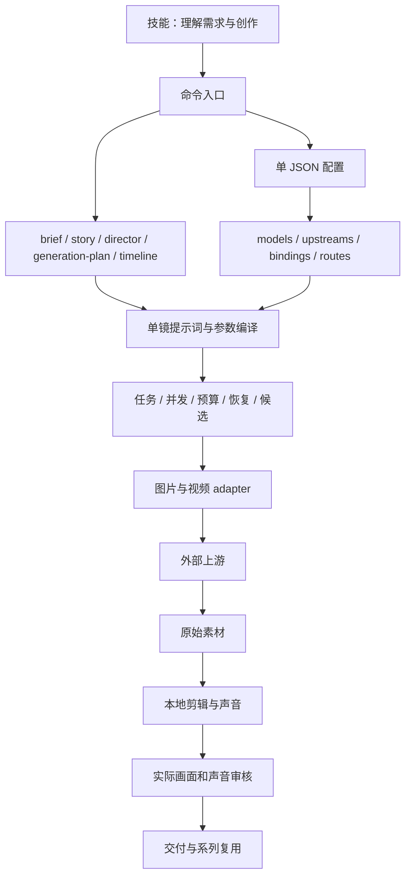
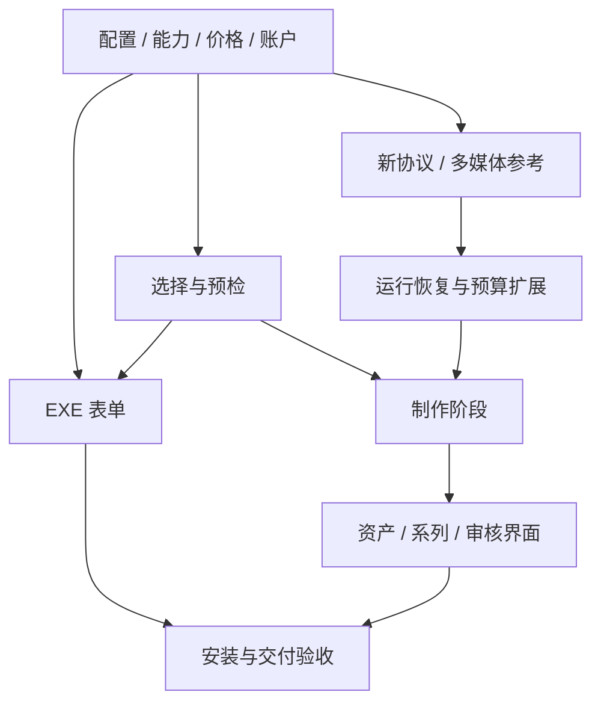

# VideoCreate：上游管理、制作流程与完整开发清单

日期：2026-11-12（北京时间）。基线：`3.0.0.dev13`，源码提交 `a1c47fce1b1509cf6154414a884d57171adab748`。

本文是需求与架构规划，不是实现报告。新增字段、命令、界面和阶段管理均为拟议设计；本轮只新增本文，不修改运行代码、技能规则、用户配置或已生成项目，不调用上游生成。

**建议保留现有执行底座，增加统一配置管理、明确的选择交互、可检查的制作阶段。** 用户维护一个权威 JSON，EXE 是它的可视化编辑入口；技能、CLI 和界面共用同一个校验与执行核心。先把“选哪家、用哪个型号、参数能否发送、做到哪一步”管理清楚，再扩展更多模型。

**本轮证据与判断范围**

- 已阅读当前技能说明、配置 Schema、路由与快照、视频 adapter、任务与预算、五层计划、动画、系列、剪辑、审核，以及历次开发和验收文档。
- 已实际查看用户提供的星光 API 模型广场截图。截图只证明该页面展示了这些型号、文字和标价，不证明 API 请求合同、当前可用性或结算价格。
- 本机配置只读结构统计为 8 个模型、4 个上游实例、19 个 binding、8 条 route；当前没有登记截图中的 Seedance 2.5 / Wan 组合，也没有配置 browser_services/workflows。未输出凭据。
- 本轮在内存中验证：现有 Schema 拒绝 binding 的 `notes` 字段、`max_prompt_chars` 字段和 `video_reference: supported`。没有写回配置或发起网络请求。
- 上一轮已运行 51 项相关离线测试且通过；本轮未重复全量测试。2026-11-11 文档记录的 475 项是历史测试结果，不能写成本轮新测。
- 旧清单存在勾选滞后，例如部分 GIF 与路由工作已有代码和后续验收记录，旧任务仍未勾选。本清单按当前代码重新归并，不累加旧文档的“待完成数量”。

**现有架构可以继续使用，但用户入口还不完整。**



这里的 models 是模型身份，upstreams 是服务地址及账户实例，bindings 是“这个型号通过这个账户、这个协议调用”的具体配置，routes 是选择规则。这个拆分已经能表示同一上游有多个 Seedance、另一上游提供 Grok、再另一上游提供 Wan，无须每次新增品牌都重写底层架构。

当前主要缺口：

| 领域 | 当前实际行为 | 对用户造成的问题 |
| --- | --- | --- |
| 配置入口 | 可以手工编辑单 JSON，校验、脱敏显示、解释生效值 | 增加一个型号要理解多个对象及关联，没有表单化管理 |
| 目录展示 | `models list` 按家族/类型/型号列出接入配置 | 没有面向日常操作的上游视图、收藏、备注和编号选择 |
| 默认选择 | 视频 job 未指定模型时使用配置默认，未指定 binding 时走 route | 尚未实现用户要求的“未指定先列选项，选择后再执行” |
| 元数据 | model/upstream 有 display_name，binding 没有通用备注字段 | 不能直接保存模型说明、适用场景、来源和注意事项 |
| 能力限制 | 有图片数量、时长范围、分辨率、画幅和提示词字节限制 | 未支持字符计数规则、视频/音频参考数量、组合限制与细粒度来源 |
| 协议 | 三种视频 adapter 和一个图片 adapter | 不能凭 `/v1` 或页面“OPENAI”标记判断新服务兼容哪个协议 |
| 价格 | 每次固定价与每秒价可相加；预算与实际账单已分开 | 无法完整表达组别、阶梯、计费取整、退款和价格有效期 |
| 证据 | 已分 configured/catalog/contract/smoke/quality | 缺少易读的逐能力详情；配置存在不等于业务可用 |
| 制作过程 | 有五层计划、动画创作文件和多个命令 | 缺少统一的主题→大纲→剧本→角色→分镜进度视图及续作入口 |
| 文档状态 | 多轮开发清单、release 记录并存 | 用户难以判断功能是已实现、只完成接口，还是已有真实样片 |

另有两个应在本轮规划中解决的技术问题：当前 binding 指纹包含 pricing 和 timeout 等 options，价格变化会影响证据索引，宜拆分展示、协议、价格和请求指纹；`config validate --ready` 仍会检查同类已启用的其他 binding，某个无关上游凭据异常可能影响已明确选择的可用路线，应增加“当前选定路线”检查，与“全配置体检”分开。

旧引擎曾有 XingAPI 专用配置，远端 ID 是 `seedance-2.0-mini-720P`，文档只记录过目录识别和未完成的协议验收。它不能证明截图中的 `seedance2.5-v`、`seedance2.5-s` 或 Wan 已接通，也不应继续靠新增 `--某站-key` 参数扩张。

**配置文件与 EXE 的关系：同一个数据源，两种操作入口。**

| 方案 | 优点 | 限制 | 建议 |
| --- | --- | --- | --- |
| 只手写 JSON | 简单、容易备份，可被技能直接读取 | 容易写错 ID、单位、路由和能力；模型多后难维护 | 保留为高级入口 |
| EXE 自己保存数据库，另导出技能 JSON | 界面操作方便 | 容易出现界面与技能读到不同版本的问题 | 暂不采用 |
| EXE 编辑权威 JSON，共用 Python 核心 | 界面、CLI、技能结果一致，可离线操作 | 需要实现表单、保存冲突和打包 | 推荐目标 |

继续使用当前位置：`%LOCALAPPDATA%/VideoCreate/videocreate.config.json`。不另建一份同样保存上游的 `providers.json`。如将来模型数量确实需要拆文件，再增加有明确优先级的导入/展开机制，不能让两个文件同时成为默认值的来源。

建议文件职责如下：

| 文件或目录 | 保存什么 | 是否人工编辑 |
| --- | --- | --- |
| `videocreate.config.json` | 上游、型号接入、备注、能力声明、价格、选择规则 | 表单或 JSON 编辑器 |
| `secrets.dpapi` / 环境变量 | API 凭据；配置里优先只保存引用 | 管理器提供凭据录入和更换入口 |
| `binding-evidence/` | 已有目录/合同/样片/质量证据 | 工具写入，界面查看 |
| `runtime/` | 健康、限流、临时目录缓存 | 工具管理 |
| `backups/`（拟议） | 配置修订、迁移前备份和差异 | 工具管理 |
| 项目内选择与阶段记录（拟议） | 本项目选择、制作阶段、输入输出版本 | 技能与工具管理 |
| 已有 `state.json`、jobs、reviews | 每次任务、实际结果和审核 | 继续沿用，不另起账本 |

程序模板与用户配置分离：升级可以提供新模型建议，但不覆盖用户自建上游、顺序、备注和密钥引用。界面保存应使用共同的校验器、配置修订号和原子替换；两个窗口同时编辑时显示冲突，不能后保存者静默覆盖先保存者。

EXE 推荐先做 Windows 本地配置管理器。技术候选是 **现有 Python 核心＋轻量 WebView 界面＋可分发启动程序**；可评估 pywebview/WebView2 和打包工具。先验证安装体积、运行时依赖、杀毒误报、中文路径与离线启动，再确定是否单文件 EXE。若 WebView 不适合，再选原生表单方案；无论选什么，界面都不另写一套路由、预算和生成逻辑。初版只需配置管理和只读任务查看，不扩张成完整视频剪辑软件。

**管理界面应该让用户按上游查看，也能按模型比较。**

```text
VideoCreate 管理器                 当前配置路径 / 修订号 / 是否有未保存修改

上游列表                 当前上游：星光 API
  星光 API               地址、账户标识、凭据状态、文档链接、备注
  Grok 所在上游          [新增型号] [从目录导入] [只读检查] [保存]
  其他 Wan 上游
  全部模型               型号                价格        能力摘要        状态
  收藏                   Seedance2.5-V       $4.9/次*   5–30 秒…       待接入
                         Seedance2.5-S       …          …              待接入
项目与任务               Wan3.0-Prime-720P   …          …              待接入

选中型号详情：基本信息｜参考与参数｜价格｜备注与来源｜协议｜实测记录
* 标价来自截图，币种及适用账户组待核实；不会自动作为已确认预算价格。
```

基本表单只暴露名称、地址、凭据、模型、启用、常用参数、备注。高级页才显示 adapter、task ID 字段、上传方式、计费规则等。可以保存资料不全的“草稿型号”，但草稿不能进入生成候选；导入模型目录也只产生待配置条目。

“设置默认”必须区分：全局以后默认、当前项目固定、当前这一次使用。对已有运行任务只显示其原路线，不能通过修改界面默认把它迁移到另一个服务。

**星光 API / Seedance2.5-V 案例：先保存声明，再补齐可执行合同。**

用户给定上游入口为 [https://xingapi.top/v1](https://xingapi.top/v1)。截图中可见 Seedance-933、Seedance2.0-933-C、Seedance2.0-933-Q、Seedance2.5-S、Seedance2.5-V 和 Wan3.0-Prime-720P。不能把这些不同型号折叠成一条“Seedance”，也不能把整个站点只归属 Seedance 家族。

| 项目 | 当前可记录的值 | 转成可执行约束前要核实什么 |
| --- | --- | --- |
| 展示名 | Seedance2.5-V | 保留页面名称 |
| 远端 ID | 截图显示 `seedance2.5-v` | 与 API 文档/目录核对大小写、连字符和实际字段 |
| 模型家族 | Seedance | 这是归类；不凭转售别名证明官方型号等价性 |
| 图片参考 | 声称 30 张 | 是否包括首帧/末帧、是否可不传首帧、单图尺寸及文件限制 |
| 视频参考 | 声称 10 个 | 单段/总时长、格式、大小、是否保留声音、实际传输方式 |
| 音频参考 | 声称 10 个 | 单段/总时长、用途、声道、格式、是否与视频参考同时使用 |
| 总参考上限 | 未知 | 30/10/10 不自动等于允许一次同时上传 50 份 |
| 分辨率 | 720P | API 接受的值与实际像素、是否随画幅变化 |
| 时长 | 5–30 秒 | 步长、整数/小数、音视频参考下是否有额外限制 |
| 画幅 | “支持全比例” | 明确枚举，或任意宽高比范围、尺寸倍数；不能解释为所有比例都合法 |
| 提示词 | 15000 字符上限 | Unicode 码点、UTF-16 单元、字节或其他计数；模板和参考标记是否计入 |
| 真人相关 | 页面原话“原生过真人” | 作为供应商说明保留，不能据此推导身份稳定、口型或所有真人输入均被接受 |
| 计费 | 按条；页面显示 `$4.9 / 次` | 实际币种、账户组、成功/受理计费、重试/失败退款、价格有效期 |
| API 协议 | 未确认 | create/query/download/upload 的确切端点、请求字段和返回结构 |

备注与结构化数据应该同时存在：

1. **备注**保存用户习惯和供应商原话，例如“短对白先做一镜”“30 图 10 视频 10 音频；按条收费”。
2. **能力声明**保存数量、范围、单位、来源、观察日期和未知项，允许不完整。
3. **执行合同**保存 adapter 真正能表达和发送的参数、组合限制及映射。
4. **实测记录**保存某账户、型号、参数和日期下的实际输出，包含回报型号、尺寸、声音和费用偏差。

备注可以被技能展示，但不能自动变成硬能力，更不能作为修改执行规则的指令。有效可发送能力应由“本次明确配置的合同范围 ∩ adapter 已实现范围”确定，再应用参考组合、价格与任务条件；实测证据单独说明可信范围。首次经授权的小样不应因为尚无自己的质量记录而永远无法开始，未知请求合同则必须先澄清。

下例仅是**拟议新版字段的局部设计草图**，不是完整配置，不能导入当前 v3 校验器。正式字段命名和迁移应在 A02 中冻结。

```json
{
  "schema_version": 4,
  "bindings": {
    "xingapi-main-seedance25v": {
      "model": "xingapi-seedance25v",
      "upstream": "xingapi-main",
      "remote_model": "seedance2.5-v",
      "enabled": false,
      "setup_status": "draft",
      "adapter": null,
      "notes": "30图片、10视频、10音频；720P；5–30秒；供应商称全比例、原生过真人；按条收费。",
      "declared_capabilities": {
        "references": {"images": 30, "videos": 10, "audios": 10, "combined_total": null},
        "duration": {"minimum": 5, "maximum": 30, "step": null},
        "resolutions": ["720p"],
        "aspect_ratios": {"raw": "全比例", "allowed": null},
        "prompt": {"limit": 15000, "unit": "characters", "counting_rule": "unknown"},
        "evidence": {"kind": "user-screenshot", "observed_at": "2026-11-12", "effective_at": null}
      },
      "pricing": {
        "unit": "request", "listed_amount": "4.9", "display_symbol": "$",
        "currency": null, "status": "declared", "billing_event": "unknown"
      }
    }
  },
  "selection": {
    "video": {"when_unspecified": "ask", "remember_scope": "project"}
  }
}
```

草稿中的 `xingapi-seedance25v` 是内部独立型号标识，避免在官方等价性尚未核实时与别家同名型号自动合并。后续只有明确建立等价关系，才能参与“同型号备用”路由。S/V/C/Q 等变体独立保留，不能仅按家族名自动互换。

配置 Schema 升级为 4 是建议，不等于软件版本必须改成 4.0，也不要求所有项目文件同步升级。配置、项目、动画创作和主题各自有版本；多媒体参考确需改变项目格式时，再做独立的项目兼容设计。

**用户选择交互应覆盖完整组合，而不是只问模型家族。**

| 用户输入或已有上下文 | 拟议行为 |
| --- | --- |
| 明确“星光 API 的 Seedance2.5-V” | 唯一解析到具体 binding 后做本地预检；在现有生成授权内直接执行，不再问选哪家 |
| 只指定“星光 API” | 只列这家符合当前任务的型号，输入序号选择 |
| 只指定“Grok 某具体型号” | 列出提供该型号的上游/账户组合，输入序号选择 |
| 两者均未指定，项目也无有效选择 | 列出候选，等待选择后才能创建付费任务；期间可继续整理剧本和本地素材 |
| 当前项目此前已选定 | 复用，不在每镜或每次继续时重复询问 |
| 用户明确要求以后都使用某组合 | 按用户要求保存全局偏好；可选“仍每个新项目询问”或“直接沿用” |
| 已有远端 task，用户说“继续” | 恢复原任务；不弹新模型选择，也不创建新任务 |
| 用户要求换上游/型号 | 先显示影响范围；只改未来未提交任务，已运行任务固定原路线 |
| 选择无效、禁用、预算不符或协议未接入 | 给出具体原因和可选替代，不偷偷换站或换型号 |

候选菜单只展示真实配置，按任务过滤后列出：序号、上游/账户、具体型号、时长/分辨率、参考能力摘要、计费、协议/实测状态。不符合请求的条目可展开查看排除原因；资料草稿不伪装成可执行选项。

图片和视频应分别选择。用户只指定视频模型，不能自动认为它也负责首帧生图；可复用此前的图片选择，确实缺少时把两项缺失选择合并询问一次。单纯注册现成图片或本地剪辑不应被无关的生图选择挡住。

编号只在一次菜单中有效，后台保存 `selection_id + config_revision + number→binding_id` 映射。用户回复“2”后必须落到当时显示的第 2 项；配置变化后重新核对，不能按重排后的列表提交。最终写入项目的是稳定 ID、选择来源和适用范围，不是数字“2”。

建议为新项目采用 `when_unspecified=ask`，将旧配置默认值作为推荐项；迁移不删除旧默认，也不改变旧任务恢复。非交互脚本缺少选择时返回结构化 `selection_required`，而不是挂起等 stdin 或自动采用收费默认。用户已授权的自动模式可以显式指定并保存策略。

选择优先顺序分两种：**恢复任务永远按原任务快照**；**新任务按本次明确选择 → 项目有效选择 → 用户明确允许沿用的全局选择 → 提问**。项目旧选择与新口头要求冲突时，以新要求作用于指定范围，并保留变更记录。

**能力和费用要帮助用户作决定，也要在提交前真正生效。**

- 提示词上限需支持单位和计数规则。当前 `len(prompt.encode('utf-8'))` 中两个汉字是 6 字节，不能把 15000 字符填成 15000 字节；应在最终编译文本上检查，且为整批所选镜头预检。
- 参考资产应区分图片、视频、音频与首帧、末帧、身份、场景、动作、声音等角色；这些角色不是所有模型都支持。禁止把 MP4/WAV 塞进现有只收图片的字段。
- 每类参考需保存数量、单文件大小、总大小、时长、格式、宽高/采样率等限制；混合参考要支持总量、互斥与条件规则。
- 若上游要求先上传获得 asset_id，必须实现上传状态、过期、重试和恢复。超时后不能把“上传成功但生成是否创建不明”混成同一状态。
- 保留供应商声明、用户覆写、adapter 约束和证据来源，能解释最终数值来自哪里；内置保守默认不得被展示成已核实的供应商承诺。
- 计费区分按任务、按生成秒数、按图片数与条件报价。生成 30 秒只剪留 8 秒，不能只按保留的 8 秒算成本；多次候选和重做分别计数。
- 若每任务确认为 4.9，同一计价档内 10 秒/30 秒可能同价；按秒计费则不同。不能为了少付调用费强行把复杂故事塞成一个长镜头。
- 跨币种默认分别统计；仅有用户确认的换算规则时才形成统一预算，保存汇率来源与时间。未知费用继续用请求次数约束，不能当 0。

**整个制作过程需要一层面向用户的步骤管理，但底层仍复用五层计划。**


模型选择不是只能在流程末端发生：用户一开始明确指定，立即记录；粗略规划时也可提前检查时长、参考与费用范围。提交前再核对完整请求，避免先写出无法实现的分镜。图中是依赖关系，不是每一步都强制用户再次点确认。

| 步骤 | 要回答的问题 | 可检查产物 | 当前基础与待补 |
| --- | --- | --- | --- |
| 主题与目标 | 做给谁看、讲什么、时长/画幅、何为成功 | brief 与一句话目标 | 已有字段，补引导式收集和缺项提示 |
| 大纲与资料 | 开始、障碍、选择、结果；依据何在 | story，动画 outline 或 research | 已有结构，补统一易读输出 |
| 剧本 | 每场发生什么、谁说什么、情绪与节奏 | 场景/动作/台词的结构化剧本和只读阅读稿 | 已分散在 story/director/animation，缺少通用剧本编辑投射层 |
| 角色/场景/道具 | 身份、服装、尺度、空间、声音如何统一 | 资产表、角色卡、主题与参考快照 | 已有项目资产与动画主题，补跨项目索引 |
| 分镜与声音设计 | 每镜让观众看到/听到什么 | director、台词窗口、首帧要求 | 已有校验与编译，补可读分镜板和来源映射 |
| 路线/参数/预算 | 使用哪一具体服务组合、能否执行、花费范围 | selection、compile、费用预演 | 已有路由与账本，补用户选择和完整报价合同 |
| 关键帧/小样 | 身份、动作、声音在当前模型上是否可用 | 首帧、相邻关键小样、实际审核 | 动画已有，补跨工作流一致入口 |
| 批量生成 | 独立镜头能否并发、哪些必须接续 | 原始素材、任务进度、候选 | 已有底座，补统一任务面板与更细配额 |
| 剪辑/后期 | 真实素材哪些部分保留，声音如何衔接 | timeline、MP4、SRT、manifest | 已有核心，补旧版编辑能力的明确复用 |
| 审核/修复 | 剧情、表演、身份、空间、声音和剪辑是否成立 | 分层回执、缺陷与修复范围 | 已有严谨规则，补播放界面与修复引导 |
| 交付/复用 | 当前是预览还是已验收，下一集复用什么 | 成片、字幕、来源、成本、主题版本 | 已有多个产物，补统一交付清单 |

阶段状态建议为 `not_started / in_progress / ready / needs_input / blocked / completed / not_applicable`，另存检查结果和版本。创作步骤“completed”仅表示该阶段产物完成，不表示视频内容已经通过；最终交付仍遵守现有 review 状态。

提供“逐步审阅”和“按现有授权自动推进”两种工作方式。仅在缺少必要选择、用户要求审阅、费用范围变化或流程确实阻塞时停下；不把 11 个步骤变成 11 次机械确认。

流程必须按任务裁剪：单镜图生视频可跳过多场剧本；现有素材剪辑直接从导入/时间线开始；无对白视频无需配音；纯生图/GIF 不要求视频模型；科普走事实证据，连载走前集结尾，独立短剧允许乱序准备。跳过步骤记录理由，不能伪造已完成产物。

剧本的可读 Markdown 应由权威结构化源导出，或通过有版本与冲突检测的显式导入更新。不能让 screenplay.md、story.json、director.json 三份同时任意手改却无法判断谁有效。新增阶段记录只保存索引和版本，不复制一份完整任务状态机。

局部修改沿依赖传播：改字幕只重做字幕/后期；换声只影响相应人物音轨及派生片；改某镜动作仅使该镜及依赖其末帧的后续镜头待更新；改默认上游不重生已完成素材；改角色身份版本需要显示受影响的首帧、镜头和审核。

**按模块盘点现状，后续功能目录也应采用这种口径。**

“已实现”指当前代码有实际入口；“部分实测”指已有特定产物记录；“待扩展”不等于需要重写已有部分。

| 模块 | 当前实现与入口 | 成熟度/边界 | 本轮后续方向 |
| --- | --- | --- | --- |
| 配置与迁移 | config init/show/effective/validate/import，旧配置迁移 | 核心已实现；无完整 v3→拟议 v4 编辑生命周期 | A、C |
| 模型目录/路由 | models list/explain-image，plan route，bindings/routes | 已实现；视频缺少通用交互选择 | A、B |
| API adapter | Sub2API JSON、NewAPI JSON/multipart、OpenAI Images | 现有协议已实现；新站与新型号需逐合同验证 | D |
| 任务/候选/恢复 | jobs run/status/resolve/candidates/select | 已实现；未知提交保持、原任务恢复可复用 | E |
| 成本/结算 | request/second 估算、预算预留、jobs settle | 已实现简单计价；复杂价格和汇总待扩展 | A06、E05 |
| 故事与导演 | plan init/validate/audit/compile/preview | 已实现；静态预演不代表真实演员效果 | F |
| 参考研究 | reference analyze/profile/attach | 已实现抽帧及观察接口；无完整自动视听理解保证 | F04、H06 |
| 动画创作 | animation study/adapt/plan/example/run/preview/review | 已实现；有特定短片实测，复杂情绪与动作仍逐片验收 | F、G |
| 身份/素材 | assets register/image/batch/handoff；animation reference/keyframes/select | 已实现项目内管理；通用素材浏览器待补 | G |
| 图片/GIF | 独立图片 adapter、输出/输入校验、media 转换 | 已实现且部分上游有实测；异步/SSE 和更多质量检查待补 | I04 |
| 连续剧/独立短剧 | series 与 animation series-init/episode | 已实现快照及连续/独立逻辑 | G06、F04 |
| 声音/声线 | 原生对白、animation voice/voice-cast/synthesize，旧版配音与口型 | 可用接口已实现；本机服务和逐字/非人脸口型实测独立 | H01–H03 |
| v3 时间线 | timeline validate/map/render，多轨、变速、叠加、SRT | 核心已实现；旧版高级编辑与新入口尚不统一 | H04–H05 |
| 内容审核 | 七层 review、图片审核、动画题眼审核、inbox/packet | 已实现证据绑定；需真实播放/听音条件 | H06–H08 |
| 科普/事实证据 | education source/validate/export/narration/map | 已实现资料结构；来源搜集与事实判断仍需代理完成 | I01 |
| 旧版新闻/模板 | legacy news、工作流模板、系列等 | 兼容入口；不是新 v3 项目的统一入口 | I01、F04 |
| Muse 网页/混合流程 | workflow list/describe/prepare | 仅离线交接包；无完整站点运行器 | I02 |
| 外部编辑器 | ChatCut 合同/回执、剪映交接包 | 依赖实际工具；剪映草稿是实验性边界 | I03 |
| 安装/发布 | install.ps1、wheel/ZIP、离仓库检查 | 已有；GUI 与新配置需加入迁移/回滚验收 | J07 |
| 社交平台发布 | 当前技能不包含 | 继续作为单独集成边界 | 不纳入本轮核心 |

建议新增机器可读模块目录，记录模块 ID、用户名称、输入、输出、依赖、现有入口、实现状态、实测状态、限制、测试证据和路线图 ID。以后“目前能做什么”由同一目录生成文档与管理器页面，不靠人工维护多份容易矛盾的总表。模块目录不是另一份用户上游配置。

**最新完整开发清单**

以下均为后续工作包；“复用”表示保留现有实现并补齐边界。P0 为当前管理和可靠选用所必需，P1 为完整制作体验和扩展，P2 为高级功能。优先级不等于把所有 P0 一次性打包；具体交付按后面的里程碑拆分。

共 73 项：P0 37 项、P1 32 项、P2 4 项。这是包含配置、界面、协议、流程、实测和发行的完整后续范围，不表示必须全部完成才能开始使用首版管理功能。

**A — 配置、元数据与能力合同。**

| ID | 优先级 | 类型 | 工作与完成标准 |
| --- | --- | --- | --- |
| A01 | P0 | 新增 | 建立机器可读模块目录和统一状态口径；每模块有真实入口、限制、实测范围、测试/文档证据和对应待办，旧清单逐项映射而不重复计数。 |
| A02 | P0 | 扩展 | 设计配置 Schema v4、草稿/启用语义及扩展策略；模型、上游、binding、route 继续分层；不完整草稿可保存但不可执行。 |
| A03 | P0 | 新增 | model/upstream/binding 增加中文展示名、notes、tags、文档链接、收藏/排序和来源时间；备注不改变任务输入哈希，不升级能力。 |
| A04 | P0 | 扩展 | 以操作为单位定义提示词计数、时长、分辨率、画幅、多媒体数量/大小/时长与组合限制；未知不是无限，空枚举不是“全支持”。 |
| A05 | P0 | 扩展 | 分离供应商声明、执行合同、用户覆写、逐能力证据；拆分协议/能力、价格、展示与请求指纹，修改标价不误使内容审核过期。 |
| A06 | P0 | 扩展 | 版本化计价：按次/秒/张、条件档位、组别、币种、取整/最低计费和有效期；估算与实付分开，未知报价不可满足硬金额上限。 |
| A07 | P0 | 扩展 | 增加非秘密账户身份、凭据版本与凭据录入服务；同账户轮换、切账户、改 URL 区分处理；活动任务可找到原账户和允许使用凭据的地址。 |
| A08 | P0 | 扩展 | 配置读改写事务、修订号、并发冲突、备份恢复、引用检查、归档；不允许删除仍被未完成任务引用的上游或破坏其凭据恢复。 |
| A09 | P0 | 新增 | v3→v4 dry-run、变更差异、应用及回滚；旧默认/自定义字段按明确策略保留，未知新版只读而不覆盖；回滚不丢新任务快照。 |
| A10 | P1 | 新增 | 导入 /models、手工录入与来源备注；目录新增/移除仅提示差异，不自动启用、删本地备注或认定能力；同名远端别名不自动合并。 |

**B — 明确选型与编号交互。**

| ID | 优先级 | 类型 | 工作与完成标准 |
| --- | --- | --- | --- |
| B01 | P0 | 扩展 | 双向目录：上游→型号、家族→型号→上游；可按任务、操作、时长、画幅、参考数量筛选，输出人读表格及机器结果。 |
| B02 | P0 | 新增 | 解析明确组合、只给上游、只给型号、均未给四类输入；唯一路线直接使用，歧义时只询问缺失选择；保留本会话已有选择。 |
| B03 | P0 | 新增 | 菜单序号绑定 selection_id、配置修订、候选稳定 ID 和任务参数；处理过期、重排、非法序号、跨项目回复与并发菜单。 |
| B04 | P0 | 新增 | 本次/项目/全局选择范围和来源；恢复旧任务优先原快照；仅用户明确要求才把一次选择保存为以后默认。 |
| B05 | P0 | 扩展 | 统一 route explain 与费用预演：列最终选择、参数消费、排除理由、来源、报价状态；选定路线就绪检查不被无关坏上游阻断。 |
| B06 | P0 | 扩展 | 切换前显示已提交、未知、已完成、未提交镜头；只调整指定的新任务；默认固定，备用需明确策略且只在确认未受理时执行。 |
| B07 | P0 | 新增 | 在图片/视频所有创建入口统一检查选择；非交互缺项返回 selection_required 且零创建，离线策划不被该选择挡住。 |

**C — 本地 EXE 管理器。**

| ID | 优先级 | 类型 | 工作与完成标准 |
| --- | --- | --- | --- |
| C01 | P0 | 新增 | 将配置/选型服务与 CLI 展示分离，供界面直接调用；确定轻量桌面技术方案，不从界面拼接任意 shell 命令或复制执行逻辑。 |
| C02 | P0 | 新增 | 上游增改/复制/归档、凭据遮蔽录入、型号增改与启用；3 个不同上游、多个家族可以纯表单配置。 |
| C03 | P0 | 新增 | 能力与备注表单、价格页、状态徽标；展示“声明支持但 adapter 未实现”，动态约束与核心校验一致。 |
| C04 | P1 | 新增 | 搜索、收藏、排序、并排比较和适用场景；单独设置图片/视频默认，显示费用单位与是否已确认。 |
| C05 | P0 | 新增 | 保存前校验、差异预览、未保存提醒、冲突处理、修复无效 JSON 和恢复备份；显示实际读取路径与配置版本。 |
| C06 | P1 | 新增 | 只读连接/目录检查、证据详情、脱敏诊断导出；检查按钮不会生成媒体；生成试测有独立入口与范围。 |
| C07 | P1 | 新增 | Windows 分发、干净机器启动、离线配置、升级与卸载；保留用户数据；明确依赖、签名/校验和及真实包体，不承诺未经测量的“小体积”。 |

**D — 星光、Seedance、Wan 与多媒体协议。**

| ID | 优先级 | 类型 | 工作与完成标准 |
| --- | --- | --- | --- |
| D01 | P0 | 核实 | 取得星光实际 API 文档/脱敏合同样例，核对 create/query/download/upload、ID、错误语义和账户报价；页面 OPENAI 标签不作为协议证据。 |
| D02 | P0 | 接入 | 将 Seedance2.5-V 做成独立 binding；协议一致则复用 adapter，不一致则新增版本；5–30 秒、实际 ID、720P、音频与按次报价各自验收。 |
| D03 | P1 | 接入 | 分别登记并验证 Seedance2.5-S 与 933/C/Q；不继承 V 的计价或参数；仅开放已核对的操作组合。 |
| D04 | P1 | 接入 | Wan 独立家族/型号/绑定，核验 Wan3.0-Prime-720P 合同；同协议复用，新协议单独 adapter；与其他上游 Wan 的等价性另记。 |
| D05 | P0 | 扩展 | 参考输入统一类型、角色和时间区间；扩展项目校验、编译、快照与审核；旧 opening-frame 图片行为保持兼容。 |
| D06 | P0 | 新增 | 按实需实现文件/URL/asset_id 上传、失效重传、来源哈希、过期和恢复；禁止静默丢视频/音频或把参考视频降为首帧。 |
| D07 | P0 | 扩展 | 适配字符/字节计数、混合参考和条件参数，实际 payload 字段有消费报告；整批错误在任何创建/预算预留之前发现。 |
| D08 | P1 | 扩展 | 按合同补查询、下载、异步/SSE 及可选 cancel/idempotency；幂等和取消必须由真实服务支持，不能本地假实现；型号硬编码迁入版本化限制。 |

**E — 运行、恢复与费用。**

| ID | 优先级 | 类型 | 工作与完成标准 |
| --- | --- | --- | --- |
| E01 | P0 | 完善 | 保留现有 unknown 保护并统一失败分类；超时/5xx/仅 trace ID 不自动重发；内容失败不得触发无痕换站。 |
| E02 | P1 | 扩展 | 区分共享账户/容量组的提交并发、远端在途、RPM、轮询与下载配额；进程重启和多个 binding 不能绕过限制。 |
| E03 | P1 | 扩展 | 按故障范围的冷却、Retry-After、退避/抖动和进度；不把一个型号失败等同全站失败，不通过付费探针自动恢复健康。 |
| E04 | P0 | 完善 | 验证改默认、改显示名、凭据同账户轮换、旧上游归档后仍恢复原任务；切账户/改域名需要保留原实例，不能误用新凭据。 |
| E05 | P0 | 扩展 | 新价格结构接入原预留/结算账本；失败收费、退款、未知、跨币种分别显示；生成秒数、保留秒数、已审核可用秒数分开。 |
| E06 | P1 | 新增 | 可重建的项目/任务索引与只读任务面板；显示队列、未知提交、候选、审核和费用；不复制一份会与 state.json 漂移的运行状态。 |

**F — 制作步骤与创作产物。**

| ID | 优先级 | 类型 | 工作与完成标准 |
| --- | --- | --- | --- |
| F01 | P0 | 新增 | 统一阶段索引、状态、输入输出版本、阻塞原因和下一步；阶段文件引用现有 job/review，不平行维护任务真相。 |
| F02 | P1 | 扩展 | 主题/受众/目标/规格的引导采集与大纲阅读稿；足够信息可继续，缺失偏好只询问影响创作的部分。 |
| F03 | P0 | 新增 | 定义通用剧本创作/投射层：场景、动作、台词、情绪与 beat/shot 映射；阅读稿与结构化源有明确单向导出或版本化导入。 |
| F04 | P0 | 扩展 | 流程分支覆盖单镜、图生视频、原创/改编动画、科普、连载、独立系列、仅剪辑、纯图/GIF；无关阶段可跳过并记录原因。 |
| F05 | P0 | 新增 | 逐步审阅/按授权自动推进策略；不每镜重新选上游，不每阶段机械求确认；付费前仍校验既有授权范围和预算。 |
| F06 | P1 | 完善 | 主题、剧本、分镜、参考、声音与模型参数的逐层映射；早期能力预演、最终请求预检；可解释一个镜头为何如此生成。 |
| F07 | P1 | 扩展 | 可视化修改影响分析与局部失效；改字幕/备注不重生视频，改动作只使相关镜和实际依赖待更新，旧候选保留。 |
| F08 | P1 | 新增 | 项目 status/next 的统一查询入口与步骤面板；“继续制作”能定位当前阶段和可复用产物，而不是从头开始。 |
| F09 | P1 | 新增 | 标准交付清单：成片/小样、字幕、分镜阅读稿、来源和素材映射、路线与成本、未核实项；草稿与正式验收明确区分。 |

**G — 角色、主题、资产与系列复用。**

| ID | 优先级 | 类型 | 工作与完成标准 |
| --- | --- | --- | --- |
| G01 | P1 | 扩展 | 建立跨项目角色/场景/道具/声音索引及素材浏览；引用时复制或快照哈希，来源修改不悄悄改变已建立项目。 |
| G02 | P1 | 完善 | 身份、服装、表情、美术与镜头构图分开；提供原图/首帧/视频对照板和角色版本更新影响清单。 |
| G03 | P1 | 扩展 | 道具可达性、尺度、状态与场景布局的共享卡片；图像资产和动作条件共同进入分镜，防止道具凭空出现。 |
| G04 | P1 | 扩展 | 角色主题、世界与风格包分别版本化；噜噜、狐狸兔子与自定义角色复用执行底座，不复制生成程序。 |
| G05 | P1 | 完善 | 展示已审核互动库与 description-only 动作建议；关联开场条件、实际区间、失败撤销与主题适配，不能把描述当实测动作。 |
| G06 | P1 | 完善 | 连载结尾与独立集初态的不同规则在界面可见；角色、声音、道具和场景引用快照完整，乱序建独立集与重选声线互不污染。 |

**H — 声音、剪辑、审核与修复。**

| ID | 优先级 | 类型 | 工作与完成标准 |
| --- | --- | --- | --- |
| H01 | P1 | 完善 | 原生对白、独立配音、保留环境音、静音的明确选择与消费报告；尊重已选路线，不因对白出现而自动安装 TTS。 |
| H02 | P1 | 完善/实测 | 固定声线、试听、局部换声与系列快照走统一界面；非人脸口型与逐字对白实测独立，不把服务健康当声音合格。 |
| H03 | P1 | 扩展 | 可选 ASR/对齐辅助实际字幕与切点；原生对白按实听结果，核对说话者、额外台词和半句截断；ASR 不自动批准音质。 |
| H04 | P1 | 复用/扩展 | 整理旧 FFmpeg 编辑器转场、滤镜、响度、字幕烧录的可复用部分，形成 v3 明确入口；不把两套命令误当完全互通。 |
| H05 | P2 | 新增 | 可选速度曲线、补帧、动态遮罩/跟踪和屏幕合成；保存源片、映射与伪影预览，实际派生片重新审核。 |
| H06 | P1 | 新增 | 集成可播放/可听的审片页、区间定位、前后镜对照与逐层记录；缺失播放/音频工具时保留未核实，静帧不能自动通过动作。 |
| H07 | P1 | 扩展 | 缺陷→局部剪辑/换声/重画首帧/重生指定镜→复验；重做前显示影响与预算，旧失败和候选保留。 |
| H08 | P1 | 新增 | 有效镜头率、可用秒数、合格镜头成本、重做率和理解反馈；说明样本范围，不以单一艺术总分代替真实判断。 |

**I — 保留并完善专项模块。**

| ID | 优先级 | 类型 | 工作与完成标准 |
| --- | --- | --- | --- |
| I01 | P1 | 复用/扩展 | 科普、地理、历史和新闻的来源/主张/旁白流程进入阶段体系；旧新闻功能按需迁入 v3；AI 示意与真实证据区分。 |
| I02 | P2 | 新增 | Muse 网页运行器在实际工具允许时完成提交/恢复/下载/对账；API Muse 独立保留；在此之前交接包明确 prepared_only。 |
| I03 | P2 | 完善/验证 | ChatCut 实际任务工具对接、剪映指定版本草稿验证；失败可回到原生 MP4；不把导出素材包当编辑器已导入。 |
| I04 | P1 | 完善/验证 | 保留 GPT/Grok 图片与 GIF 现有能力，补每 binding 的生成/编辑/动画合同和循环/体积/透明度检查；异步/SSE 按实需开发。 |
| I05 | P2 | 实测/优化 | 模型专属提示词、场景基准、延迟分布、成本和质量比较；只有可比样本才给用途推荐，跨型号替代单独可选。 |

**J — 验证与交付。**

| ID | 优先级 | 类型 | 工作与完成标准 |
| --- | --- | --- | --- |
| J01 | P0 | 测试 | Schema/迁移/凭据引用/未知字段/并发保存/断电原子性/撤销与旧版只读；真实用户配置不进入发行包。 |
| J02 | P0 | 测试 | 四种选择输入、重复名、过期序号、配置变更、同项目续作、无头缺项零创建、图片视频独立选择。 |
| J03 | P0 | 测试 | 每 adapter × operation 的 create/query/download/upload fixture，大小写精确 ID、字符/字节、多参考边界、价格单位和跨账户隔离。 |
| J04 | P0 | 测试 | 提交后崩溃、未知提交、已知任务恢复、下载失败、凭据轮换、路由变化、并发预算；检查实际请求次数和账本，不仅检查返回值。 |
| J05 | P0 | 测试 | 全流程分支、跳步、阶段恢复、局部失效、小样与全片区别、系列快照、审核过期；不允许字幕修改触发视频重生。 |
| J06 | P1 | 实测 | 在后续明确生成授权和预算内做逐 binding/操作的小样，记录真实 ID、时长、尺寸、参考语义、声音和费用；选择界面不能把离线测试标为在线通过。 |
| J07 | P1 | 交付 | 全回归、离仓库 wheel/ZIP/EXE、升级/回滚、可选依赖、文档/Schema/模块目录同步；提供可复现验收记录和已知限制。 |

**依赖与交付顺序**



| 里程碑 | 主要范围 | 用户能实际验收的结果 |
| --- | --- | --- |
| M1 配置与选择最小闭环 | A02–A09、B01–B07，必要 E01/E04/E05，J01/J02/J04 | 无须编辑多个关联对象；已明确组合直接用；未指定列序号；保存和切换不影响旧任务；先用现有已接通路线验证。 |
| M2 可视化管理器 | C01–C07、A01/A10，J07 对应部分 | 双击界面管理 3 个上游和多个型号，查看备注/能力/价格；保存后技能立刻读到同一修订；关闭 GUI 后 CLI 仍可用。 |
| M3 星光与多参考接入 | D01–D08、E02–E05、J03/J06 | 先核对并测试 Seedance2.5-V 的基本生成，再按已核实合同逐步启用多图/视频/音频；S/933/Wan 分项验收，不因其中一项通过全站标绿。 |
| M4 制作流程统一 | F01–F09、G01–G06、H01–H04/H06–H07、J05 | 一条完整视频能按主题、大纲、剧本、角色、分镜、生成、剪辑、审核继续制作；修改一个部分只重做必要部分。 |
| M5 质量与扩展 | H05/H08、I01–I05、剩余 E06/J06/J07 | 基于真实输出做用途推荐、成本报告和专项功能；浏览器/外部编辑器按实际接入能力开放。 |

M1 不需要等星光新协议才能完成，M2 也能先管理现有 Grok/图片路线。M3 的合同核实可在早期进行，但不能在协议未知时承诺只改 JSON 就能调用所有功能。M4 的剧本/阶段设计可以提前明确，落地时保持已有创作和执行模块可复用。

首轮最值得完成的交付是 **“能在界面录入并保存＋能从对话按序号选择＋旧任务恢复不受影响”**。高级补帧、自动动作控制、全自动浏览器和完整剪辑器不应拖慢这条核心路径。

**实施时应逐项通过的用户场景**

1. 建立星光、Grok 服务、另一家 Wan 服务；同一个站点也可同时有 Seedance 和 Wan，各自能力/价格独立。
2. 用户说“使用星光 Seedance2.5-V”，唯一匹配后不再询问模型；若协议尚未接入，准确指出缺项，不能假装已可生成。
3. 用户只说“生成视频”，无已有选择时展示候选，回复序号后只使用当时显示的组合。
4. 选择后修改全局默认或重新排序，当前项目和远端已受理任务均不漂移。
5. 图片使用 A 上游、视频使用 B 上游，两个选择与费用分别记录。
6. 15000 字符、30 图片/10 视频/10 音频和“全比例”有明确计数与组合语义；未知项不会被转成无限能力。
7. 按次与按秒的价格预演可比较；未知币种、账户组和折扣明确显示，生成时长与剪辑保留时长不混算。
8. 用户只改备注、标题或字幕，零新增视频创建；换角色或某镜动作时能列出具体受影响资产。
9. 一个镜头提交超时，保存 unknown；切换默认或重启管理器都不会让它自动再付费创建。
10. 同一项目关闭后继续，定位到真实未完成步骤，并复用已有素材、候选和审核；新独立集不继承别集状态。
11. 管理器升级或配置迁移失败，可以恢复原配置；已创建远端任务仍可按原地址/账户查询。
12. 最终显示“代码已实现”“目录可见”“协议可发送”“特定样片通过”“仍未知”各自状态，不用一个绿色勾代表全部。

**源码和既有证据索引**

| 证据 | 路径 |
| --- | --- |
| 当前使用约定 | [SKILL.md](../videocreate/SKILL.md) |
| 配置语义 | [configuration.md](../videocreate/references/configuration.md) |
| 严格字段/能力范围 | [config/schema.py](../videocreate/src/videocreate/config/schema.py) |
| 原子写入、配置位置和凭据读取 | [config/storage.py](../videocreate/src/videocreate/config/storage.py) |
| binding、指纹、能力与候选 | [catalog/bindings.py](../videocreate/src/videocreate/catalog/bindings.py) |
| 菜单现状/命令入口 | [commands.py](../videocreate/src/videocreate/commands.py) |
| 协议准备及真实字段 | [adapters/video.py](../videocreate/src/videocreate/adapters/video.py) |
| 任务原路线恢复 | [runtime/jobs.py](../videocreate/src/videocreate/runtime/jobs.py) |
| 现有计价与预算 | [runtime/budget.py](../videocreate/src/videocreate/runtime/budget.py) |
| 五层字段与参考角色 | [planning/schema.py](../videocreate/src/videocreate/planning/schema.py) |
| 动画与系列现有入口 | [animation/commands.py](../videocreate/src/videocreate/animation/commands.py) |
| 2026-11-11 动画实测范围 | [动画逐项核验](20261111-animation-story-completion-audit.zh-CN.md) |
| 模型与 GIF 既有实测范围 | [2026-11-07 验收记录](20261107-model-routing-gif-acceptance.zh-CN.md) |
| 旧 XingAPI 接入边界 | [multi-model-upstream-development.zh-CN.md](multi-model-upstream-development.zh-CN.md) |
| 旧总开发清单 | [v3 开发计划](videocreate-v3-development-plan.zh-CN.md) |
| 旧多模型开发清单 | [模型路由与 GIF 清单](20261107-model-routing-gif-development-plan.zh-CN.md) |

以上新增工作尚未开发。本规划建议在需求确认后按里程碑逐批实现，验收记录随实际结果更新，保留不成功和未核实的范围。
