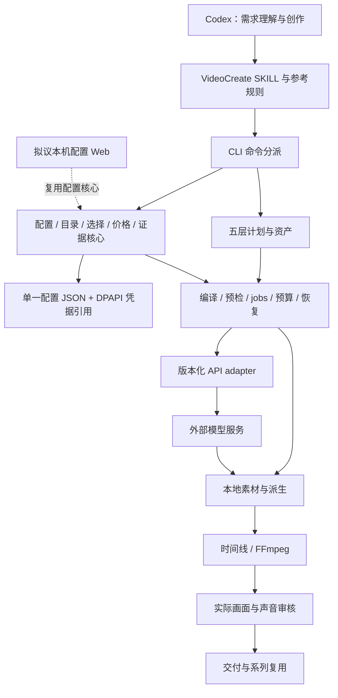

# VideoCreate 新对话完整交接

交接日期：2026-11-13，Asia/Shanghai。工作目录：`F:/VideoCreate`。本文件面向没有读过旧对话的开发者。

迁移补充：本仓库已完整复制到 F 盘，原 E 盘目录保留。继续开发使用本文件所列 F 盘路径；先阅读[迁移说明](20261113-f-drive-migration.zh-CN.md)，其中记录完整复制校验、历史路径处理与本机配置边界。C 盘已安装技能和权威配置未迁移。

## 1. 先读的结论

**用户需要一个本机 Web 上游配置工具，视频制作仍在 Codex 中由 VideoCreate 技能执行。** 不再以 EXE/Tk 为主界面，不建设网页视频工作台。维护同一份权威配置和既有 Python 执行核心，重点解决配置界面丑、难用、保存层级多的问题。

**最终最新决定仍是 Web，但默认输入简化为 URL 和 Key。** 显示名/备注可选；账户标识、model/binding/route、协议和参数由 Codex 结合只读目录及已知合同维护。高级编辑保留为可选，不要求用户首次填完整内部结构。仅 JSON 的用户入口已取消，相关三个新文件已撤回。自动匹配仍待正式实施，不能用收费 POST 猜协议，不能承诺任意 URL/Key 即插即用。

当前有三个状态必须分开：

| 层 | 当前事实 |
| --- | --- |
| 已发行/已安装 | `3.0.0.dev43`，最后提交 `aed9f160ed8d07007ab5b2ef3950706ce0d3a207`，完整回归 1063 项通过 |
| 未完成源码 | `3.0.0.dev44`，11 个既有修改/新文件涉及 Tk 强退草稿恢复；专项通过，但 manager 回归 107 项中 2 项失败，未发行未安装 |
| 本轮设计交付 | 独立交互 HTML 原型、设计说明、完整 73 项开发台账及 W01–W22 Web 子任务、交接文档；没有正式 Web 服务或真实配置写入 |

原 73 项的 dev43 基线：11 项离线实现、60 项部分实现、2 项待开发。不能称为“73 项全部完成”，也不能用离线测试数证明实际视频参考、对白、口型或费用已验收。

本轮用户只授权做原型和交接。此前长期目标已由用户清除；不要自动恢复旧目标或创建新目标。用户在新对话明确要求实施后，再按本清单推进；若用户明确提出目标模式，再创建目标。

用户另外授权清理测试产物和旧逻辑。本轮已清理约 1.34 GB 生成文件，旧源码/测试/原型在用户决定回到 Web 后完整恢复；正式 UI 退役在替代功能验收后进行。完整清理记录和恢复归档见[清理记录](20261113-cleanup-record.zh-CN.md)。当前 `acceptance/`、`dist/`、`build/` 等目录已经移到仓库外归档，下文历史证据路径需在归档中读取。

## 2. 本轮交付入口

| 文件 | 用途 |
| --- | --- |
| [Web 交互原型](prototypes/provider-config-web.html) | 直接打开，演示上游切换、模型编辑、草稿导入、比较、默认设置 |
| [Web 设计说明](20261113-web-provider-config-design.zh-CN.md) | 产品边界、信息结构、数据/HTTP 设计、启动、安全与验收 |
| [最新完整开发清单](20261113-complete-development-checklist.zh-CN.md) | 原 73 项需求逐项保留，附已有实现、剩余、验收、路径及 Web 子项 |
| [机器可读清单](20261113-development-checklist.json) | 73 项状态/映射和 22 个 Web 子项；不是运行配置 |
| [新对话启动提示](20261113-new-chat-start.zh-CN.md) | 可复制到新对话的继续开发说明 |
| [保护基线](prototypes/handoff-preservation-baseline.json) | 11 个既有产品文件和权威配置的哈希；不含配置内容/密钥 |
| [原型验证](prototypes/provider-config-prototype-verification.json) | 10 组浏览器交互、零 JS 错误和零外部请求 |
| [清理与恢复记录](20261113-cleanup-record.zh-CN.md) | 已清理范围、私有归档位置、源码/测试恢复和原项目保护 |
| [简化入口截图](prototypes/provider-config-simple-entry.png) | 新增上游默认只填 URL/Key，不必填账户 ID 和显示名 |

原型是独立 HTML/CSS/JS、纯演示数据、页面内存保存。没有读写真实配置、导出 Schema 4、调用上游、启动服务或保存真实密钥。UI 中三家/七个接入与本机五家/25 接入无关。备份/历史部分只有解释入口。测试不能抵扣正式 Web 验收。

本轮文档包用于把上下文带到新对话；它不是完整源码/项目/凭据备份。继续开发应使用当前工作目录和现有 Git 历史，并保留未提交文件。

## 3. 用户需求与优先顺序

1. 轻松管理多家上游：一家很多 Seedance，另一家 Grok，另一家 Wan；同名模型在不同账户/上游分别接入。
2. 每个接入能保存中文名、精确远端 ID、备注、参数、参考能力、价格、来源和实测记录。
3. 用户在 Codex 明确上游和型号时，唯一解析后在已有授权内使用；缺项/歧义才列编号菜单等待选择。项目已经选过就复用。
4. Web 只配置；主题→大纲→剧本→角色→分镜→生成→剪辑→审核→交付的创作流程保留在技能。
5. 启动本机端口后自动打开浏览器，不再开发 EXE UI。配置保存后浏览器可关闭。
6. 分清“已实现/部分实现/待开发”和“离线/目录/真实生成/实际内容/实付”的证据，清单保持完整。
7. 首次接入尽量只填 URL/Key，Codex 负责目录/合同匹配，未知协议具体说明缺少什么文档，不把复杂配置重新推给用户。

最新边界覆盖旧路线图里 EXE 主界面、项目表单、时间线/任务面板等扩大方向。旧功能可保留并由 Codex/CLI 复用，不能顺势把它们搬进新 Web。

供应商备注属于数据，不是技能指令；文档样例用于核对合同，不授权额外收费探针。用户历史上允许本机配置及使用测试模型，不代表这次原型请求需要再生成视频。

## 4. 当前软件架构

### 4.1 技术栈与分发

- Python 包 `videocreate`，源码位于 `videocreate/src/videocreate/`。
- `pyproject.toml` 声明 Python ≥3.9，核心运行依赖为 `[]`；现有媒体处理按需依赖 FFmpeg/FFprobe、Pillow 等。
- setuptools 构建 wheel；`setup.py` 的 `BuildSkill` 将 SKILL、scripts、assets、references、agents 收进 `_skill` 资源，须保持包和可复制技能内容一致。
- `videocreate/scripts/videocreate.py` 是薄 CLI 启动器；`cli.py` 分派至各服务；根命令 `videocreate`。
- 旧 `videocreate-manager` / `scripts/videocreate_manager.py` 启动原生 Tk 管理器；PyInstaller 通过 `tools/build_manager.py` 打包便携 EXE。这是旧界面，不是 Web。
- `install.ps1`、`build-release.ps1`、`MANIFEST.in`、`tools/check_release.py` 管理安装/发行/隐私检查。后续 Web 静态资源需要加入 wheel 与技能安装验收。

拟议 Vue3/TypeScript/Vite + FastAPI/Uvicorn 尚未加入依赖、源码或发行包。采用可选 Web 依赖，运行配置页无需 Node；前端构建结果由 Python 同源托管。详细选择见设计说明。

当前运行时是 Python 3.9.12，新增 Web 依赖必须验证兼容并冻结版本；若提升最低 Python 版本，需要明确的运行时迁移和安装验收，不能盲目使用最新版依赖。

### 4.2 调用与数据关系



单一配置包括四个核心实体：`models` 内部型号，`upstreams` 地址/账户实例，`bindings` 精确远端 ID/adapter/操作能力的接入，`routes` 新任务路由。一个网页“模型行”主要对应 binding。品牌/家族不是协议，模型别名相似也不意味着等价。

项目的五层是 brief、story、director、generation-plan、timeline。导演层有场景/动作/台词/beat/shot；生成层有 jobs/依赖/route/有序参考；时间线有保留区间、声音、字幕、叠加、转场与处理。`state.json`、任务/候选、账本和 reviews 继续作为各自权威状态，不另建 Web 任务数据库。

## 5. 模块盘点与代码入口

下表路径相对仓库根。链接指向当前实际文件/目录。详细逐项缺口在 73 项台账，不因表格简化而删除。

| 模块 | 当前实现与入口 | 保留缺口 |
| --- | --- | --- |
| 配置与 Schema | [config](../videocreate/src/videocreate/config/)；schema/schema_v4、storage、management、effective、repair、secrets；CLI config/providers | Web DTO/事务、复杂迁移与跨文件断电恢复；草稿 UI 重设计 |
| 上游目录 | [catalog](../videocreate/src/videocreate/catalog/)；bindings/presentation/observations/discovery/presets | 正式 Web；逐地址/账户/型号的真实可用性 |
| 能力和报价 | media_constraints/pricing/evidence；capabilities show、models explain、providers compare/filter | 通用条件组合、真实边界/价格/退款；无可比在线排行榜 |
| 编号选择 | [selection.py](../videocreate/src/videocreate/selection.py)；selection list/choose/impact | 自然语言别名、所有旧入口、多菜单/项目回归 |
| 旧管理器 | [manager.py](../videocreate/src/videocreate/manager.py) 及 manager_* | 停止扩展为主界面；dev44 未完成，不把旧表单整体迁 Web |
| 视频/图片协议 | [adapters](../videocreate/src/videocreate/adapters/)；video/image/xingapi/xingapi_references | 每 binding×operation 的实际参考/声音/费用；原生幂等/cancel/SSE 按文档 |
| 素材直链/切片 | [media_server.py](../videocreate/src/videocreate/media_server.py)、media_references/reference_slices | 独立 Python 服务启动迁移、更多真实参考语义；S3 非当前前置条件 |
| 任务/恢复/成本 | [runtime](../videocreate/src/videocreate/runtime/)；jobs/state/failures/reconcile/settlement/budget/quotas/health | 跨进程边界、外部机器配额不在覆盖内、实际退款/账单 |
| 计划/剧本/阶段 | [planning](../videocreate/src/videocreate/planning/)、authoring/generation_authoring；[production.py](../videocreate/src/videocreate/production.py)、production_continue/policy | 更全面创作质量和分支联通；自动策略不等于无人值守生成循环 |
| 资产/动画/系列 | [asset_library.py](../videocreate/src/videocreate/asset_library.py)、project_assets、animation、series | 主题/世界/风格独立包、跨版本板、真实身份/接触/连贯性 |
| 本地导入与图片/GIF | local_sources/still_images/image_production/local_gifs/legacy_edit_import | 各模型图片编辑/GIF 在线验收；复杂混合派生 |
| 时间线与声音 | [timeline](../videocreate/src/videocreate/timeline/)、timeline_authoring；render/model/transitions/finishing/overlays | 速度曲线/补帧/跟踪未实现；波形/可播放拖拽编辑不是配置 Web 范围 |
| 实际媒体审核 | [review](../videocreate/src/videocreate/review/)；page/receipts/packet；production_metrics | 连续播放/听审/理解反馈和真实样本；抽帧/解码不代替内容验收 |
| 科普/新闻 | [education.py](../videocreate/src/videocreate/education.py)、保留 legacy 来源/主张流程 | 按需迁 v3；不把 AI 示意当事实证据 |
| Muse/外部编辑器 | [workflows.py](../videocreate/src/videocreate/workflows.py)、对应 references 和 legacy 工具 | 网页仍 prepared_only，ChatCut/剪映实际导入待验证；新会话重新确认可调用工具 |
| 离线诊断 | [diagnostics.py](../videocreate/src/videocreate/diagnostics.py)；providers diagnostics/diagnostics-export | 只摘要已保存配置/缓存/证据；不是原日志/全项目任务诊断 |
| 构建/安装/测试 | [pyproject.toml](../pyproject.toml)、setup.py、install.ps1、tools、[tests](../tests/) | 正式 Web 及静态资源发行、干净机器、升级与独立服务迁移 |

dev43 机器模块目录中有 catalog、capabilities、selection、manager、xingapi、references、runtime、production、animation、audio、editing、review、education、browser、external-editors、images-gif、benchmark、release、provider-diagnostics。benchmark 为 planned；不要把目录里的历史 release 文案取代最终 dev43 验收记录。

### 5.1 已有重要边界

- `xingapi-video-v1` 为旧任务保留，文生视频为主；`xingapi-video-v2` 实现按类型的 HTTPS 参考数组。既有配置没有全体自动升级，需逐 binding 明确合同后切换。
- `media_server.py` 是素材 GET/HEAD 服务，不是管理 API；拒绝写方法，不能在其公网入口直接增加配置 CRUD。
- 本地 `review page` 导出可播放 HTML 是项目审片产物；打开页面没有审批效果。动作看连续视频，声音要实际听审。
- 时间线格式 2 引入转场；3 引入受控滤镜/LUFS/字幕烧录；4（dev38+）支持源增益、音频循环、画面淡入淡出、限幅与 slide-left。格式升级不代表旧渲染器可安全忽略新字段。
- 原生旧 edit-plan v1/v2 迁移创建独立 edit-only 项目，源/历史保留，旧审批不继承。
- 配额是本机已注册 v3 项目范围；不宣称控制上游账户在其他机器/客户端的全部流量。

## 6. 本机配置、凭据与服务

### 6.1 权威路径

```text
仓库：F:/VideoCreate
技能：C:/Users/FBX/.codex/skills/videocreate
配置：C:/Users/FBX/AppData/Local/Packages/OpenAI.Codex_2p2nqsd0c76g0/LocalCache/Local/VideoCreate/videocreate.config.json
旧管理器：配置目录/manager/3.0.0.dev43/VideoCreateManager.exe
旧技能备份：C:/Users/FBX/.codex/skill-backups/videocreate-pre-dev43-8cb96e0021
历史发行原相对路径：dist/dev43/（已移入清理归档）
历史旧管理器发行：dist/manager-dev43/（已移入清理归档）
私有恢复归档：F:/VideoCreate/_local/archive/json-only-20261113-171206/retired-ui-and-generated-files.zip
```

统一路径解析支持 `VIDEOCREATE_CONFIG_DIR` 和显式配置路径；桌面进程的 LocalAppData 可能与普通终端不同。以实际返回路径为准，新 Web 启动必须明确显示并与技能一致，不能意外初始化另一份默认文件。

最近已保存结构统计：Schema 4、5 个上游、14 个内部模型、25 个 binding、14 条 route、5 个草稿、19 个启用，涉及 gpt-image/grok/muse/seedance/wan。数字表示登记结构，不表示各操作都在线验证。本轮不在文档复制真实配置。

密钥已经配置到本机，不索取、不输出、不写进前端/示例/文档/公开日志。配置优先保存 DPAPI/环境引用。DPAPI 绑定原 Windows 账户，JSON 备份不是可跨机器恢复的密钥备份。保留旧凭据版本供原任务恢复。

### 6.2 公网素材与隧道

- 本地素材端口：`8765`，loopback 文件服务。
- 公网地址：`https://videofiles.hn.takin.cc`。
- ZeroNews 是内网穿透；已实测目标为 **HTTP → host.docker.internal:8765**，不是容器自身的 127.0.0.1。
- dev43 发行验收记录服务由旧 dev42 PID 2948 切到 dev43 EXE PID 2176，公网实例匹配，PNG/MP4/WAV 完整哈希一致，验收发布随后撤销。
- 上述 PID/在线状态是该次验收历史，本轮没有重新验证，不可拿旧 PID 盲目停止进程或宣称当前在线。
- 不再让用户重复改已正确的隧道，也不因“不再 EXE UI”立即删除承载服务的 EXE。W20 先验证新的独立服务启动，再迁移。
- 配置 Web 计划用 `127.0.0.1:8787`，目前没有启动/实现；不要公网转发它。退出配置 Web 不应影响 8765。

素材本机存储+HTTPS 隧道是用户当前选择。不要再把提供 S3/COS/OSS 的 Bucket/Key 当继续开发前置条件。现有素材只发布经明确选择的文件，不以目录浏览暴露本机其他文件。

## 7. 真实生成案例与未完成审片

已有项目：`projects/20261112-ancient-cs-comedy/`。

成片：`projects/20261112-ancient-cs-comedy/deliverables/程序员当皇帝-重启大明-原声高清版.mp4`。

- 远端精确 ID：`seedance2.5-V`；已创建一次，约 30.048 秒，1280×720，24 fps，有音轨，完整技术解码通过。
- 是参考视频启发的“古代×计算机专业”喜剧；原参考视频没有上传给模型，不可将其写成视频参考语义验收。
- 页面/本地已核对报价为 USD 4.90/次，实际账单金额未取得，不能写成已支付 4.90。
- 连续动作、实际对白、听审、口型和理解反馈仍未全部完成，交付保持 `review_pending`。
- 不为测试新 UI 再次生成，不删除原任务/素材/版本。技术能播不能自动通过艺术和声音验收。

用户原参考：`E:/Microsoft Edge Downloads/下载 (11).mp4`。历史截图在 `E:/TEMP/`，部分最初文件可能是临时文件；关键接口合同已经落入 references，继续时不必依赖旧截图仍存在。

## 8. 已核对的 XingAPI 合同

上游入口：`https://xingapi.top/v1`。用户提供了完整视频接口说明，参考 [xingapi-contract.md](../videocreate/references/xingapi-contract.md)。早期“文档需登录”已经被用户提供的合同补齐，不要再次问同样基础文档。

1. 创建：POST `/videos/generations`，显式 model/prompt/duration/ratio/resolution。
2. 多媒体：`images`、`videos`、`audios` 是独立有序 HTTPS URL 数组；`generate_audio` 仅在型号明确支持时发。音频参考和生成声音是不同含义，不同时发冲突字段。
3. 保存完整 `id/task_id/request_id`，包括 `videoprep_` 等前缀；可能位于 data 对象。没有 task ID/连接中断视为提交不明，保留证据，不自动 POST。
4. 查询：GET `/videos/{完整 ID}`，使用创建时原账户/Key。queued/processing 继续查同一任务。
5. 临时断网、502/503/504、空响应只影响查询；429 遵循 Retry-After。客户端停止等待不是服务端取消。
6. 下载：完成后 GET `/videos/{ID}/content`，可跟随 302；跨域不转发本站 Authorization。检查状态、Content-Type 和文件，不把 JSON/HTML 保存成 MP4。
7. 临时链接过期时先按原任务重新查询，下载失败不重新生成。原生取消和幂等必须有具体服务承诺，X-Client-Request-Id 只是核对线索。

“30 图、10 视频、10 音频、全比例、真人、15000 字符”等是每型号的供应商声明，需要分离数量/总量/条件/计数方式和真实测试，不能把全部写成已证实执行能力。

## 9. dev43 发行证据

见 [dev43 详细验收](20261113-dev43-acceptance.zh-CN.md)；其历史摘要原路径 `acceptance/20261113-dev43/dev43-final-summary.json` 已移入上述私有 ZIP，不能再按当前工作区文件存在来描述。

| 证据 | 结果及适用范围 |
| --- | --- |
| 最终源码提交 | aed9f160ed8d07007ab5b2ef3950706ce0d3a207；当时干净 |
| 完整回归 | 1063 项，失败/错误/跳过均 0，Tk/析构/unraisable 警告均 0 |
| 源码冻结哈希 | acf2089af5f3e0d5f289ec9a21d42aceeb27456ec5e6a57fe2b30016559bb2c1 |
| 安装比对 | 241 个技能文件与源匹配，1058 个管理器文件与构建匹配 |
| 用户数据保护 | 当次安装前后 1205 个配置/凭据/项目文件保持 |
| wheel | 844825 字节；SHA256 89f85bbde63a7cf8f9e21858993e1cdde33f2ef7e9efb05b26096fe272811909 |
| 旧 EXE ZIP | 11088313 字节；SHA256 1eb3d4368c7868835503ac0a8122f4616ab09a111455891e58712ca3bc7ff1bb |
| 仓库外 | 诊断、目录、筛选、修复、草稿、生命周期、混剪/本地派生、策略、迁移、转场等夹具通过 |
| 仍未验收 | 干净机器、用户视觉易用性、实际片段连续动作/听审、每 binding×operation 的参考/声音/结算 |

历史测试不是本轮重跑结果。特别注意源码已变为未完成 dev44，不能沿用 dev43 的零失败来宣称当前工作树全通过。

## 10. dev44 未完成工作必须保留

当前分支 `codex/provider-manager`。产品/测试既有修改如下；本轮文档原型以外没有动它们。精确哈希见保护基线 JSON。

```text
M  videocreate/SKILL.md
M  videocreate/assets/module-catalog.json
M  videocreate/references/provider-management.md
M  videocreate/src/videocreate/__init__.py
M  videocreate/src/videocreate/manager.py
M  videocreate/src/videocreate/manager_media.py
M  videocreate/src/videocreate/manager_pricing.py
?? tests/test_config_drafts.py
?? tests/test_manager_recovery.py
?? videocreate/src/videocreate/config/drafts.py
?? videocreate/src/videocreate/manager_recovery.py
```

这组工作是 Tk 的 DPAPI 恢复快照：约 1.5 秒定时检查、同版本/旧进程已停止/配置来源未变的恢复门禁，未提交凭据不入快照。它不是本轮 Web 方案的一部分。

已执行：8 项 config-draft 测试、15 项 manager-recovery 测试通过；真实强杀生产者后的恢复夹具通过，配置/密钥存储保持。

证据原路径：`acceptance/20261113-dev44/check-process-recovery.py`、`process-recovery.json`、`manager-regression.log`，现保存在清理归档的同名相对路径。

尚未解决：107 项 manager 回归有 2 项失败，且出现 `ttk::ThemeChanged` 警告：

```text
test_clip_import_close_removes_pending_poll_and_keeps_one_started_transaction
test_gif_window_close_removes_its_pending_poll_while_conversion_finishes
```

观察到旧测试按根窗口全部 after 定时器判断关闭后是否清空，新加根级草稿定时器仍存在。该现象是原因线索，不是已完成的修复结论；主题警告也不能略过。

完整 dev44 回归、重新构建、安装和发行未完成。下一迭代应先审计能复用的 `config/drafts.py` 服务；不要为了补完旧路线继续打磨 Tk 恢复 UI。可以经源码隔离/另提交保留未完工作，再实施 Web，但不得用 reset/clean/覆盖恢复抹掉这 11 个文件，也不要把它们混入“Web 已完成”版本说明。

如果全回归仍包含旧 manager 测试，需要明确隔离方案或实际修复，不把已知失败直接忽略为全绿；方案应服务可维护性，避免继续扩展旧界面。

## 11. 正式 Web 实施的关键约束

完整设计见另一文档。新开发者尤其要留意：

1. `config.management.load(path)` 返回原始 config，可能含旧明文和引用，不能直接 HTTP 返回。建白名单 DTO，密钥只写、状态只读；不能将遮蔽后的整 config 保存回去。
2. 核心 `management.save(path, value, expected_token=..., reason=...)` 已有锁、校验、修订、备份、恢复身份保护。后端加载当前权威值、应用白名单变更、预览绑定来源和草稿，再保存，不通过 shell 调 CLI。
3. `secrets.store_credential(root, account_id, value, version=...)` 保留旧版本。浏览器不把密钥放 localStorage/草稿/URL/日志；跨文件中断需设计恢复。
4. `catalog/observations.py` 按地址和账户区分观察；导入禁用草稿且绑定来源，目录消失只提示。
5. `diagnostics.py` 是 allowlist 离线服务，不外部查密钥、不联网、不生成。已有 JSON 内的明文值可能用于本机清理，报告不输出；不要误写成完全不接触任何已保存明文。
6. 只绑定 loopback，同时测试 Host/Origin/CSRF、CORS、DNS rebinding、会话引导、CSP。Web 不注册 jobs execute、视频创建、任意文件、shell 和通用 URL 代理。
7. 配置页零生成。真实试测由 Codex 在既有授权/预算内走原执行底座；Web 不增加“生成测试”后门。
8. `8787` 与 `8765` 分离；旧服务先迁后退，配置窗口关闭不终止生成或素材直链。
9. 新路由/启动命令都还是设计，不向用户报告已经能执行 `config-web`。页面只显示产品所需字段，复杂协议放高级设置。
10. 新增上游默认 URL/Key；保存先成功、目录/合同整理再独立报告。无 /models 的服务保留输入，查已有文档。Codex 按文档匹配已有 adapter，不因家族名/兼容标签批量启用，不用生成探针猜协议。详细完整接入流程见设计说明第 0 节。

## 12. 最新开发清单和建议下一步

[完整 73 项台账](20261113-complete-development-checklist.zh-CN.md)保留所有原需求；Web W01–W22 是其中 A/B/C/J 等项的子任务，不是多加 22 项完成率。

| 阶段 | 范围 | 完成判断 |
| --- | --- | --- |
| M0 | 本轮原型、清单、交接 | 可打开原型、文档自包含、文件保护与验证记录完成 |
| M1 | W01–W06 + W18 初始启动 | 安全本机只读目录、真实路径与版本可见，不泄漏秘密 |
| M2 | W07–W11、W13、W16 | 三上游表单→预览/保存→技能读取；密钥/冲突/恢复闭环 |
| M3 | W12/W14/W15/W17/W21 | 比较、目录导入、证据、诊断、草稿与易用性 |
| M4 | W18–W20/W22 | 启动分发、Codex 联调、旧任务与素材服务迁移、全回归 |
| 后续 | D/E/F/G/H/I/J06 的真实缺口 | 按真实项目价值与授权推进，不扩配置 Web 为创作台 |

新对话获得开发授权后，建议先做以下具体工作：

1. 读本文件和设计/清单，确认 Git 状态、已安装版本和保护基线，区分未完成 dev44。
2. 审计 config/catalog 服务，冻结 DTO 和只读/预览/提交合同，选择隔离 dev44 的方式并保留源码。
3. 新建可选 Web 工程，复用原型视觉结构，先用安全 DTO 连接真实只读数据；同时补最必要的 HTTP 安全测试。
4. 加入 URL/Key 的简化保存和只写凭据，内部 ID 自动生成；再打通 Codex 目录/已知合同整理、模型/默认等。每批给出可打开结果与实际验收，不一开始造全套工作台。
5. 正式版通过专项后做完整回归、仓库外构建/升级和静态资源检查。未经测试不替换本机稳定安装。

不需要重复询问已明确的产品边界、隧道目标或已给过的基础视频合同。常规可逆实现选择可以自主处理；真正缺少合同或收费范围时才提出有依据的必要问题。

## 13. 可复现读取与验证命令

以下 PowerShell 命令用于只读检查和离线原型验证，不创建媒体。相对路径均从本仓库根运行。

```powershell
Set-Location 'F:/VideoCreate'
git status --short
git rev-parse --abbrev-ref HEAD
git rev-parse HEAD

# 分别确认安装版本与当前源码版本，不能混用两者的验收。
& 'C:/Users/FBX/anaconda3/python.exe' -X utf8 'C:/Users/FBX/.codex/skills/videocreate/scripts/videocreate.py' version
& 'C:/Users/FBX/anaconda3/python.exe' -X utf8 './videocreate/scripts/videocreate.py' version

# 重建文档清单：只读取指定 dev43 Git 提交，不读真实配置。
& 'C:/Users/FBX/anaconda3/python.exe' -X utf8 './docs/prototypes/build-development-checklist.py'

# 浏览器原型验证：需要本机 Chrome 与 Playwright，使用演示数据。
$env:VC_PLAYWRIGHT_MODULE = 'C:/Users/FBX/.cache/codex-runtimes/codex-primary-runtime/dependencies/node/node_modules/playwright'
& 'C:/Program Files/nodejs/node.exe' './docs/prototypes/verify-provider-config.cjs'

# 文档/原型/源码保护/包检查；包构建命令见脚本 --build-bundle。
& 'C:/Users/FBX/anaconda3/python.exe' -X utf8 './docs/prototypes/verify-handoff.py' --build-bundle
```

后续修改核心时，专项示例（会运行测试，用隔离临时目录；当前交接任务未重跑产品全套）：

```powershell
$env:PYTHONPATH = (Resolve-Path './videocreate/src').Path
& 'C:/Users/FBX/anaconda3/python.exe' -X utf8 -m unittest discover -s tests -p 'test_provider_management.py'
& 'C:/Users/FBX/anaconda3/python.exe' -X utf8 -m unittest discover -s tests -p 'test_catalog_observations.py'
& 'C:/Users/FBX/anaconda3/python.exe' -X utf8 -m unittest discover -s tests -p 'test_submission_unknown.py'
```

dev43 完整 runner 原路径为 `acceptance/20261113-dev43/run-final-regression.py`，现已移入清理归档，作为历史方法参考。它及 install/finalize 脚本含固定版本、路径和产物，不能直接对新版本照跑或误执行旧安装；新发行要建立自己的源码冻结/产物/安装记录。

本机 Python 为 3.9.12（`C:/Users/FBX/anaconda3/python.exe`）；Node 在 `C:/Program Files/nodejs/node.exe`；FFmpeg/FFprobe PATH 在 `D:/ffmpeg-7.0.2-essentials_build/bin/`。这些是当前机器路径，不是对其他机器的依赖发现方案。

## 14. 证据与文件迁移

下列目录被 Git 忽略：`acceptance/`、`projects/`、`dist/`、`build/` 等。当前 projects 保留在本机，acceptance/dist/build 已移入清理归档。换电脑、另克隆仓库或迁 worktree，Git 不会自动带走项目和私有归档。

保留 dev43/dev44 本地验收、原视频项目、必要发行产物和用户配置/凭据的安全备份。不要把凭据、完整配置、原始任务/签名 URL 直接塞进公开交接 ZIP。本轮 ZIP 只收录设计文档、演示原型、截图、清单与验证，文件清单/哈希由验证脚本生成。

历史参考：[原 73 项路线图](20261112-provider-management-and-production-roadmap.zh-CN.md)、[开发进度](20261112-development-progress.zh-CN.md)、[dev43 验收](20261113-dev43-acceptance.zh-CN.md)。历史路线图中 EXE 及早期小写模型 ID/旧配置数字不代表现在状态；以本文件、当前核心和最新用户指令为准。

## 15. 后续开发持续遵守的不变量

- 恢复原任务优先其保存的 URL、账户、精确 ID、adapter 与允许凭据；改默认不搬旧任务。
- 创建一次后保存完整 ID；提交不明先对账。查询、下载失败不再 POST；X-Client-Request-Id 不是通用幂等承诺。
- 固定路线不偷偷切模型。备用只在确认未受理且策略明确时使用。
- 选择编号绑定 selection_id/配置来源/候选/项目；过期时重列，不解释成新列表同序号。
- 备注、目录、能力声明、可执行合同、小样、质量、实际账单分别记录。
- 不因修 UI、字幕、备注、价格说明而生成新视频，不抹掉旧失败/候选/未知账本。
- 原始素材、派生片、最终片分别哈希与审核；原片通过不自动批准剪辑，计划通过不自动批准影片。
- 同步源码、技能、Schema、模块目录、构建产物和安装版本；未完 dev44 不能借用 dev43 的验收标签。

下一位开发者应围绕“轻量、好用、配置专用”交付本机 Web，并让 Codex 继续承担真正的视频制作。
