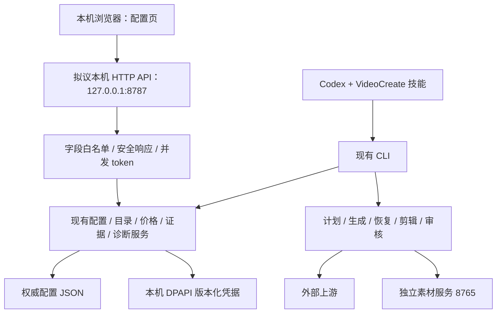

# VideoCreate 本机 Web 上游配置：原型与实施设计

日期：2026-11-13。本文和 HTML 原型是设计交付，不是正式 Web 功能发行。最新边界以本文、完整开发清单和本轮用户要求为准。

最新决定：使用本机 Web，保留“用户主要只填 URL 和 Key”的简化体验。不再实施仅 JSON 的用户入口。新增上游时默认只展示 URL、Key；显示名称和备注可选，账户标识、协议、model/binding/route 由 Codex 与工具维护。后文模型编辑和协议表单是可选的高级维护能力，不能成为首次使用必填步骤。

## 0. 简化后的完整接入逻辑

1. 用户打开本机页面，填写 API URL 和 Key 并保存。名称默认取域名，可改；内部稳定 ID 由后端生成，不让用户填写 account_id/binding/route。
2. 后端保存地址和版本化凭据，返回“已保存、待整理接入”；保存和识别分别报告结果，目录检查失败不丢用户输入。
3. 用户明确执行只读检查时，工具请求该上游的模型目录并保存观察；检查仅 GET，不发送可能创建媒体的 POST。`/models` 不存在时保留配置，转查已有文档。
4. Codex 在使用技能时结合已有适配器合同、地址/账户范围内缓存和供应商公开接入文档，选择**已有且合同匹配的** adapter，登记精确远端 ID、操作和已确认参数。优先复用用户已经提供的 XingAPI 合同，不重复索取。
5. 模型家族名、`/v1` 地址、目录存在或“OpenAI 兼容”标签都不能单独证明视频协议。文档不足时说明具体缺少的请求/查询/下载例子，允许用户提供文档链接；不要求用户亲手写 adapter，也不以多种收费 POST 轮试。
6. 已确认操作进入可选候选；参考、音频、报价或组合范围未知的部分继续标记未知。不把同站所有型号批量视为全部兼容，也不要求每个首次授权小样先有自己的历史小样证据。
7. Codex 按用户需求和候选列序号；上游/具体型号唯一明确时直接按已有授权预检。选型属于 Codex 对话，不把生成任务放进配置页。
8. 已提交任务始终用原地址、账户、凭据版本、adapter 和完整 task ID 恢复。改 URL 或无法证明同账户的换钥创建新实例、保留旧实例，不让新 Key 静默访问旧任务。

上述自动接入整理是**待开发的正式功能**，原型仅演示两个字段的输入方式。当前核心仍需要完整内部配置，已有 Codex 可通过核心服务维护它；本轮不宣称任意 URL/Key 已能自动生成。一个权威 Schema 4 JSON 继续供技能使用，用户通过 Web 维护，不新增需要用户管理的第二份 JSON。

## 1. 产品定位

Web 页面只负责维护上游与模型配置。用户在本机启动服务，自动打开浏览器，配置完成后回到 Codex 使用 VideoCreate 技能制作视频。后续生成只读取已经保存的权威配置，不要求配置页始终打开。

| 入口 | 负责的事情 |
| --- | --- |
| 本机配置 Web | 上游地址、账户身份、密钥录入、模型接入、参数能力、价格、备注、收藏、默认策略、目录检查、配置备份和诊断 |
| Codex + VideoCreate 技能 | 理解参考视频、主题、大纲、剧本、角色、分镜、选型提问、生成预检、创建、恢复、下载、剪辑、审片、交付 |
| 现有素材服务 | 将明确发布的项目素材通过 HTTPS 提供给模型读取；与配置管理服务分开 |

本轮不把项目、生成按钮、任务执行、剧本编辑、时间线或视频剪辑搬进 Web。既有 Python 核心和 CLI 能力继续保留。旧 Tk 界面、EXE 和相关测试作为历史实现保留，停止扩展为新的主界面。

## 2. 打开原型

- [交互原型](prototypes/provider-config-web.html)：独立 HTML，直接打开即可，不需要安装和启动服务。
- [桌面截图](prototypes/provider-config-desktop.png)、[模型表单截图](prototypes/provider-config-editor.png)、[窄屏截图](prototypes/provider-config-mobile.png)。
- [URL/Key 简化入口截图](prototypes/provider-config-simple-entry.png)：默认两个输入，名称/备注折叠为可选。
- [原型验证记录](prototypes/provider-config-prototype-verification.json)、[浏览器验证脚本](prototypes/verify-provider-config.cjs)。

原型使用三家上游、七个接入的演示数据，与用户真实配置数量无关。所有“保存”只更新页面内存，刷新即恢复。它不读写本机 JSON，不存储密钥，不联网，不创建任何媒体。界面中的价格、能力和状态用于展示信息层级，不构成实际合同或在线验收。

### 已可操作的交互

1. 切换星光、Grok、Wan 示例上游，或查看全部模型。
2. 按关键词、媒体类型、家族、收藏筛选。
3. 点击模型查看参数、声明、报价与逐操作证据说明。
4. 新增/编辑上游；新增默认只填 URL/Key，自动取域名作为显示名，生成内部账户标签；密钥框输入不进入持久化或演示数据状态。
5. 新增/编辑模型，在基础、能力、价格、备注来源、高级协议五个页签中修改，并一次保存。
6. 校验草稿启用和时长边界；不合法时保持编辑内容。
7. 模拟从目录导入：已有条目保留，新条目是禁用且未配置协议的草稿。
8. 选择 2–4 个模型比较；分别设置图片和视频默认及“未指定先询问”策略。
9. 模拟只读目录检查、操作记录和匿名诊断预览。
10. 查看设置、配置路径示意、备份恢复入口；重置原型。

其中备份恢复、历史差异等只是解释入口；不会生成真正的备份。目录请求、凭据加密、保存冲突、崩溃草稿、HTTP 安全、正式 Schema 映射和真实服务启动都没有实现。本原型不应作为配置 JSON 导出器。

## 3. 信息结构与界面规则

左侧固定“上游管理、模型目录、默认选择、检查与记录、设置”，下方列常用上游。桌面主区是模型表格，右侧是选中模型详情；窄屏改为上下排列。主要信息使用浅色底、统一行高、深绿主按钮，减少同屏按钮和协议字段。

| 页面 | 核心内容 | 主要动作 |
| --- | --- | --- |
| 上游管理 | 当前上游地址、账户标签、密钥状态、模型表格、详情 | 新增上游、编辑上游、新增模型、目录导入、只读检查 |
| 模型目录 | 跨上游接入，图片/视频和家族筛选、收藏 | 搜索、比较、进入具体接入编辑 |
| 默认选择 | 图片、视频各自默认 binding，缺省处理策略 | 保存明确的全局策略；不修改已有项目和任务 |
| 检查与记录 | 最近只读检查、配置修改摘要、逐操作证据 | 查看原因、脱敏诊断预览与导出 |
| 设置 | 实际路径、配置版本/修订、备份恢复、本机服务信息 | 预览恢复差异、应用恢复、查看版本与路径 |

首页直接进入上次选中上游。模型表格优先展示名称/精确远端 ID、类型、能力摘要、费用单位、配置状态。资料多时通过详情和编辑页展开，不在每行堆叠所有字段。

“目录可见”“配置已启用”“合同就绪”“文生视频小样通过”“参考视频实测通过”必须是不同状态。避免用一个绿色“可用”同时表达它们。“未知”保留为未知，不显示成不限量或免费。

接入整理进度用“已保存→目录已读取→合同已匹配/待补文档→可选操作”表达。基本页显示结果与原因；执行合同编辑放进高级设置，Codex 维护结果也保留来源和变更记录。

### 表单与保存

每个实体编辑窗只有一个“保存”提交点，取消保持原文件。价格档位子编辑只更新当前表单草稿，再由模型表单统一提交，避免“应用到父窗→主窗再保存”的双重操作。成功后显示修订号和已写入位置；失败仍保留当前输入。

正式实现需提供脏状态提示、字段级错误、变更预览、重复点击保护、保存中状态和冲突处理。关闭浏览器时的提醒只能作为辅助，不能承诺拦截强制退出；必要草稿由后端按来源 token 保存。未提交密钥不放入草稿、localStorage、日志或浏览器历史。

原型主要展示信息架构和编辑体验，正式版须补充键盘选择表格、焦点回收、屏幕阅读器标记、缩放、长中文名称和高对比度验收。

## 4. 数据模型：继续一份权威 JSON

不新增另一份平行的 providers.json 或界面数据库。当前 Schema 4 的层级继续使用：

| 层 | 含义 | 示例 |
| --- | --- | --- |
| model | 内部模型身份及媒体类型/家族 | 某个独立 Seedance 型号 |
| upstream | 服务地址与账户实例 | 星光某地址的某账户 |
| binding | 某内部型号通过某账户、精确远端 ID、指定 adapter 的接入 | 星光账户下的 seedance2.5-V |
| route | 新任务的选择规则 | 固定首选 binding 及明确允许的备用策略 |

界面里的一行“模型”通常对应 binding，展示名可以友好，内部 ID 和远端 ID 不合并。精确远端 ID 必须保持大小写；已成功案例为 `seedance2.5-V`，不能直接照抄早期截图/旧路线图中的小写变体。

现有权威配置位置：

```text
C:/Users/FBX/AppData/Local/Packages/OpenAI.Codex_2p2nqsd0c76g0/LocalCache/Local/VideoCreate/videocreate.config.json
```

实际路径必须由统一解析结果返回，不能依赖原型里的 `%LOCALAPPDATA%` 示意。启动器支持显式指定配置，Codex 和 Web 必须确认读到同一路径。

### 能力、备注、价格和证据

- 备注：适用场景、供应商原话、个人经验、文档链接和观察时间，作为普通文本展示。
- 声明：如“30 图/10 视频/10 音频、5–30 秒、720P、15000 字符”。它可以不完整。
- 执行限制：以具体操作为单位，在 adapter 已实现范围内设置可验证的数量、单位、计数方式和组合条件。
- 证据：目录、合同、小样、质量各自记录账户/地址/操作/输入参数/时间与有效范围。
- 费用：页面标价、可用于预算的已核对报价、实际账单分开；单位、币种、组别、有效期不能省略。

例如“支持全比例”先保留供应商原文；未核实合法枚举时，不能自动允许任意宽高比。30/10/10 也不能自动推断可同时混传 50 份。“原生过真人”不能推导口型、身份稳定或质量已通过。备注文字不是技能指令，不能改变执行规则。

目录导入仅保存精确 ID、来源 URL 的受控元数据、观察时间和本地完整性哈希，生成禁用草稿；不根据名字自动选择 adapter、价格或能力。导入不得清除原备注、覆盖旧 binding 或删除未再次出现的条目。

## 5. 拟议技术架构

建议采用 **Vue 3 + TypeScript + Vite** 实现前端，**FastAPI + Uvicorn** 实现薄 HTTP 服务，直接复用现有 Python 核心。这是待实施选择；当前项目没有这些生产依赖，现有核心 `dependencies=[]`。

前端在构建阶段生成静态文件，正式使用时由同一个本机 Python 服务提供静态资源和 API。用户运行时不需要 Node，Node 只用于开发/构建。Web 依赖作为可选安装组，维持纯 CLI 的轻量安装。静态文件、字体和图标随包分发，离线可配置。

当前本机 Python 为 3.9.12，工程最低版本也是 3.9。实施 W02 时须冻结仍兼容该版本的 Web 依赖并验证安装；若决定提升 Python 最低版本，必须把运行时迁移、旧安装和干净环境验证一并列入实施，不能直接安装最新框架后假定可用。



建议新目录如下，**目前不存在，不表示已经实现**：

```text
web/provider-config/                 Vue 前端源码和构建测试
videocreate/src/videocreate/config_web/
    app.py                          仅配置管理路由
    dto.py                          请求/响应白名单及错误映射
    service.py                      核心服务适配、来源 token、预览
    security.py                     本机会话、Host/Origin/CSRF
    launcher.py                     端口、实例识别、启动和浏览器
    static/                         前端构建产物
```

接口层不能调用 Tk，也不要通过 shell 拼 CLI 命令。现有 `management_commands.py` 是 CLI 包装；HTTP 应直接调用 `config/management.py`、catalog 及 diagnostics 核心。

### 浏览器 DTO 边界

`config.management.load(path)` 的 `config` 是内部原始数据，可能含明文旧凭据或凭据引用，**不可直接 JSON 返回浏览器**。列表只返回所需展示字段和 `credential_present / credential_source / update_available` 等状态，不回显密钥或加密内容。

保存使用实体白名单和 `expected_token`；后端重新加载当前配置，应用允许的字段变化，再交给核心校验和事务保存。浏览器不提交整份被脱敏的 config，不能把 `***` 写回成为密钥，未展示字段也不能因编辑而丢失。

密钥更换是独立的只写请求：请求体中传入，立即交给本机 DPAPI 服务，返回新引用状态。保留原凭据版本供已提交任务恢复。同账户换钥与换账户/地址分开；后一种创建新的 upstream ID，保留原实例。配置与凭据跨文件提交的失败/断电恢复需要专门设计；孤立新版本可安全回收，不能先破坏原引用。JSON 备份不等于跨电脑可恢复的凭据备份，DPAPI 通常绑定原 Windows 用户。

### 拟议 API 分组

以下均为设计，不能当作当前可用端点。具体路由命名在实施时冻结。

| 接口 | 职责与复用核心 |
| --- | --- |
| GET /api/session、/api/config/summary | 实例身份、软件/Schema/修订、允许展示的路径与摘要 |
| GET /api/upstreams、/api/bindings | 安全 DTO；复用 management/catalog，支持筛选 |
| POST /api/changes/preview | 白名单草稿的校验、差异与影响，返回来源绑定 preview token |
| POST /api/changes/commit | 校验相同来源/草稿 token，再调用 management.save |
| POST /api/upstreams/{id}/credential | 只写凭据及版本轮换；不回显，不自动测试 |
| POST /api/upstreams/{id}/catalog-check | 用户明确点击的只读 GET /models；范围、超时、地址和账户受控 |
| GET /api/upstreams/{id}/catalog | 读取已缓存观察，不自动联网 |
| POST /api/catalog-import/preview、/commit | 绑定观察来源，导入禁用草稿，通过统一配置提交 |
| POST /api/bindings/compare | 本地能力/价格/证据对比，零生成、无凭据解析 |
| GET /api/defaults；默认变更走 changes | 图片/视频默认和缺省策略；不修改项目 |
| POST /api/diagnostics/preview、/export | 复用 allowlist 诊断，先预览后导出到新的文件 |
| GET /api/backups；POST /api/restore/preview、/commit | 受控 backup ID、精确备份和身份保留；不允许任意路径读取 |
| POST /api/repair/inspect、/preview、/apply | 损坏 JSON 专用流程，原始字节绑定、原文备份、新版只读 |

错误响应统一包含错误码、字段路径、可读原因、是否需要重新加载，原始异常须脱敏。并发冲突建议 HTTP 409；Schema/字段错误 422；不支持的新版返回只读状态，不能自动降级。

HTTP 层不注册 jobs execute、视频生成、项目任意读写、通用 shell、通用 URL 代理或任意文件系统访问端点。所谓“只读目录检查”允许写受控观察缓存，但不更改配置和创建媒体；按钮文案必须说明。

## 6. 启动、端口与本机安全

拟议命令 `videocreate config-web` 和双击启动脚本目前尚未实现。未来启动顺序：解析实际配置→检查依赖→绑定 loopback→验证本服务实例→建立本机会话→打开系统浏览器。支持显式 `--config`、`--port` 和 `--no-browser`，具体参数名待实施。

- 配置服务建议使用 `127.0.0.1:8787`，只绑定本机。重复启动只复用匹配服务身份、版本与配置路径的实例；端口被其他程序占用则给出明确处理，不直接打开未知服务。
- 8765 是现有素材服务，不复用为配置 API。公网域名 `https://videofiles.hn.takin.cc` 的隧道目标是 HTTP → `host.docker.internal:8765`，不要将 8787 也转发出去。
- 服务只接受预期 Host，验证写请求 Origin 和 CSRF/短期会话，禁用宽泛 CORS。仅监听 loopback 仍须处理跨站请求和 DNS rebinding。
- 会话秘密不放 URL 查询、浏览历史或日志，不能嵌入公开静态 JS。启动引导与同源会话建立方式需在 W04 里审查和测试；不要把凭据当会话令牌。
- CSP、纯文本备注、严格字段大小、请求体限制和受控重定向共同验证。连接检查只向配置中明确允许的上游地址发出；避免把任意输入变成网络扫描或凭据转发。
- 关闭配置页只结束配置会话，不停止 Codex 的远端任务；退出配置服务不停止素材服务。素材链接需在生成期间持续有效。

旧素材服务最近一次发行验收由 dev43 EXE 承载，因此“不要 EXE 界面”不等于立即删除 EXE 或杀掉其后台进程。需要后续迁移到独立 Python 启动器，先验证同端口/实例/文件哈希/恢复，再退役旧启动方式。

## 7. Codex 与配置协作的最终体验

1. 用户在 Web 填写三家上游的 URL/Key，保存到同一份 JSON；Codex 按上述流程整理模型与已知合同，参数和备注可在高级页维护。
2. 回到 Codex 说“用星光的 Seedance2.5-V 做一条古代程序员喜剧”。唯一 binding 就按已有生成授权预检使用。
3. 只说“用 Seedance”或未指定时，Codex 按真实配置和任务条件列稳定编号菜单，用户回复序号。Web 不承担这次生成的选择对话。
4. 选择默认作用于本次/项目；只有用户明确要求才改全局。图片模型与视频模型分别处理。
5. 中断后继续，按原 task 快照的账户、URL、精确 ID、adapter 恢复；Web 修改默认不会移动旧任务。

Web 保存成功不等于已授权花费；只读检查不等于视频能力已验证；任务完成不等于影片内容审核通过。这三层继续由现有技能与核心规则区分。

## 8. 实施顺序与验收

完整 W01–W22 子清单与原 73 项映射见[完整开发清单](20261113-complete-development-checklist.zh-CN.md)。建议先交付安全的只读壳，再做配置提交和密钥，之后接入目录/比较/默认/恢复，最后做启动、打包与 Codex 联调。

首版完成必须满足：三家上游能只填 URL/Key 建立配置，内部标识自动生成；已知合同可由 Codex 匹配，未知合同明确待补资料且零试错创建；精确 ID/能力/备注/价格保存后 Codex 读取一致；两个窗口保存能发现冲突；无效 JSON 有受控修复路径；密钥不出现在响应、日志、浏览器持久化及诊断；所有页面操作不创建媒体；配置服务启动/关闭不影响 8765；离线可保存配置；旧任务仍以原路线恢复。原型的 10 组浏览器检查只证明演示交互，不能抵扣上述正式验收。
