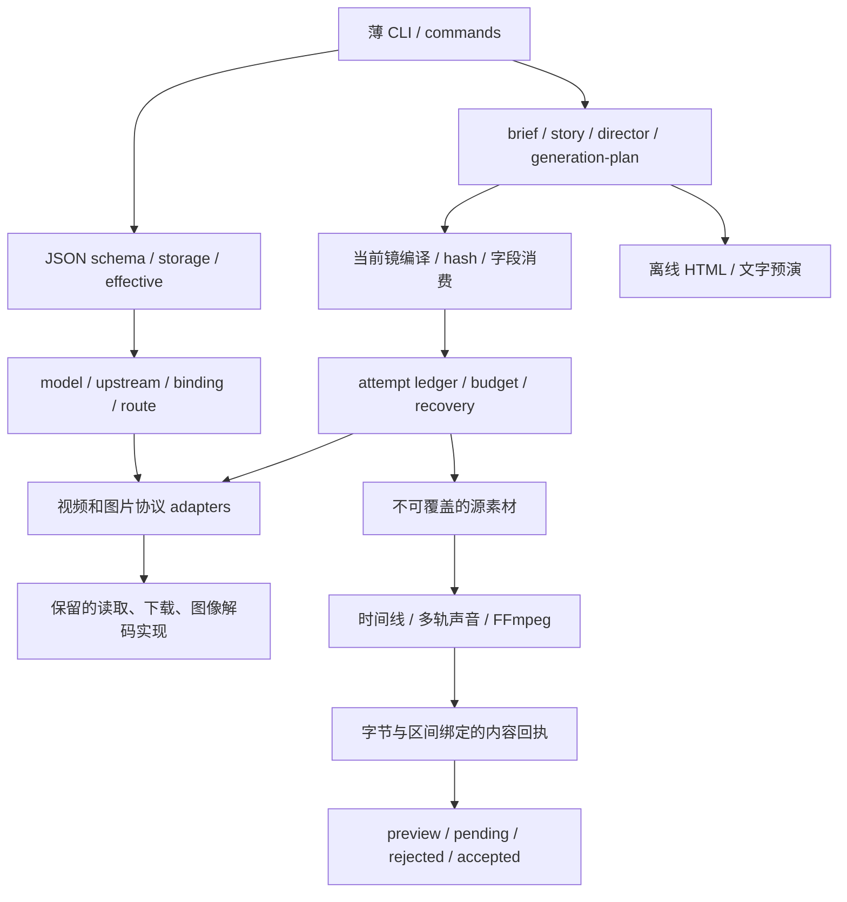

# VideoCreate v3 开发版实施与验收

日期：2026-11-02。版本：`3.0.0.dev1`。适用范围：本地工程重构、离线内容规划与恢复能力；远端模型质量验收另列。

## 1. 原问题与本次改动

旧片的问题分布在剧情、导演、执行和验收四层。原五镜的表演/视线/方向合同为空，长动作挤入短镜，生成片段几乎整段使用；喜剧被当作非叙事，状态变化理由可用任意文字放行，结构检查又曾被报告成剧情通过。7.56 秒仍可见车徽。这些问题不能靠增加“电影级、流畅、真实”几个词解决。

新流程先定义观众应理解的目标、障碍、选择和结果，再拆成可见事件、表演与镜头。生成任务与剪辑片段有不同 ID，保留窗口、反应特写、独立对白和局部速度可以单独修改。内容验收必须对应实际字节和保留区间，计划字段完整只能得到 structural pass。

| 领域 | 已实现行为 | 验收边界 |
|---|---|---|
| 品牌 | VideoCreate 产品、videocreate 技能/包/CLI、安装与发行脚本 | 旧名称只保留兼容读取、旧文件 shim 和历史审计 |
| 配置 | 单一 JSON；models/upstreams/bindings/routes；脱敏与 effective 来源 | 首次配置未启用视频路由会报告 setup_required |
| 协议 | Sub2API JSON、NewAPI JSON、NewAPI multipart；独立图片 adapter | payload fixture 通过不代表远端实现相同合同 |
| 能力证据 | configured/catalog/contract/smoke/quality 分项记录 | 目录可见不升级为生成成功；证据不自动扩大能力 |
| 运行 | 先保存 attempt/预算/请求；unknown 保持；已知 task 固定原实例 | “查不到”仍不能触发重发；本地停止不声称远端取消 |
| 预算 | 并发原子预留、次数和金额限制、实际账单凭证对账 | 未知费用不会被写成零；实际费用需上游证据 |
| 创作 | 因果状态、信息覆盖、表演触发/注意/反应/决定、空间与接触 | 机器校验声明逻辑；实际动作仍需视频审核 |
| 提示词 | 当前镜投影、长度阻断、参考哈希、明确现代产品例外 | 其他镜演员和结局不进入本镜提示词；不静默压缩 |
| 素材 | 注册参考图、独立图片预算、未知图片提交保持/恢复 | 身份/道具参考须先组合成开场帧；多角色参考未实测 |
| 剪辑 | 半开素材窗口、独立 segment、多轨声音、局部变速和字幕映射 | 24 fps 半速仍仅约 12 个源帧样本/秒；未实现光流插帧 |
| 审核 | narrative、motion、identity、spatial、audio、clean-frame、editorial | 静帧不能证明整段运动/无徽标；同字节失败优先 |
| 预演 | 可编辑 30 秒十段剧情、HTML 和文字卡片 MP4 | 没有生成真实演员、配音或电影画面 |

## 2. 模块依赖与抽离边界



包在 `videocreate/src/videocreate/`，薄入口在 `videocreate/scripts/videocreate.py`。保留的历史项目、系列、新闻、声音和编辑实现仍位于 scripts；原引擎通过集中 bridge 调用新 binding。新导演、任务、时间线与审核业务不继续堆入旧入口。

导入包、配置验证、计划校验和编译不发起远端创建。只有显式的 `jobs run`、`assets image` 才进入生成；本轮开发没有执行这些远端付费操作。`doctor --read-only` 只查询目录，本轮本机检查使用默认离线 doctor。

## 3. 可复核验证

回归与专项验证记录保存在本机 `analysis-frames/videocreate-migration/`。测试包含原有回归、协议 payload、trace/task 分离、unknown 保持、任务实例固定、路由备用、并发预算、实际 FFmpeg 媒体、慢画面/正常声音、审核证据过期与失败优先、图片原结果恢复及安装失败回滚。

最终在 VideoCreate 物理目录执行完整回归：**347 项全部通过**（289.569 秒）；最新 v3 专项 **54 项通过**。全量测试运行中最后补充的场景地理/轴线编译改动另外由这组专项和十镜编译复验覆盖。

wheel 从临时目录、仅加载已安装包执行 version/config init/validate/plan init/validate/compile/preview/legacy install-plan，通过禁止 Python socket connect 的检查。ZIP 在独立临时目录完成干净安装、保留 basic 档位的升级、文字预演与卸载，配置保留。发行扫描 wheel 130 文件、ZIP 152 文件，通过。源码 Markdown 相对链接检查无缺失；技能 quick_validate 通过。最终发行哈希在本机 `dist/*.sha256` 和 `analysis-frames/videocreate-migration/` 留存。

Python 本机使用 3.9 运行回归，3.12 构建并隔离验证 wheel。Windows 实际测试不等同于已在 Linux/macOS 实机验证；CI 配置覆盖 Windows/Linux，路径单测覆盖 XDG 和非 DPAPI 凭据来源。

原片 `projects/three-kingdoms-smart-car-20261101/deliverables/final.mp4` 保留原字节，SHA-256：`ed65caa56252cbde90253ec5ac4affaeda8632fc2bcdd09b7d5aa4b21d04ca32`。旧片没有因重构自动变好，也没有重新标记为清洁通过。

## 4. 本机迁移与兼容期

新配置在 `%LOCALAPPDATA%/VideoCreate/videocreate.config.json`，旧配置与 DPAPI 原文件保留。新技能安装到 `~/.codex/skills/videocreate`；旧技能移到 `~/.codex/skill-backups/`，避免两套技能同时被发现。配置、模型缓存和用户项目不进入发行包，升级不会重新下载可选模型。

旧项目采用“保留运行方式并写入迁移回执”，不把旧创作字段机械转换成已合格的 v3 导演计划。原任务 ID、attempt、签名、模型、adapter、素材哈希和失败证据保留；继续使用 `legacy <原命令>` 或兼容脚本。这个调整保证旧付费任务可恢复，同时让新工作遵守新合同。下一个破坏性主版本之前保留旧 Python 文件、环境变量、配置路径与双锁兼容；移除前须先发布迁移说明和验证工具。

物理仓库目录已为 `E:/MyFiles/ToolSkills/VideoCreate`，原 `GrokVideoSkill` 根为指向它的 junction，不维护两份源码。Windows 的运行中工作目录阻止直接 Rename-Item，因此迁移工具先移动已核实的子项，再将空旧目录原地设置为 junction；临时目录演练和本机迁移均成功，Git 工作区能从新路径读取。本机技能已最终同步，`version`、配置 ready 与示例计划校验通过。旧项目 project/state、原片和 DPAPI 原始字节复核保持不变。

## 5. 本地试用

```powershell
python videocreate/scripts/videocreate.py config init
python videocreate/scripts/videocreate.py config open
python videocreate/scripts/videocreate.py config validate --ready
python videocreate/scripts/videocreate.py config effective
python videocreate/scripts/videocreate.py plan init <新目录> --example smart-car
python videocreate/scripts/videocreate.py plan validate <新目录>
python videocreate/scripts/videocreate.py plan preview <新目录> --video
```

模板提供 Grok/Seedance × Sub2API/NewAPI 四个独立 binding 和一个图像 binding。新用户只启用实际可用的项，填写上游 URL、密钥来源和精确 remote_model。Seedance 示例 ID 只是可编辑模型标识；远端别名须以自己的渠道合同为准。固定路由不会在失败后自行换服务。

例子已有“堵路→受阻→汽车出现→军师反应→导航绕路→粮到→士兵拜车→军师无奈”的信息链，另有收尾笑点。实际生产先选相邻两镜验证人物和动作，再扩展全片。文字预演不能作为身份或声音质量样本。

## 6. 尚未验收与后续开发

| 项目 | 状态 / 下一步 |
|---|---|
| Grok、Seedance × 两类上游的真实视频合同 | 本轮未发起付费生成；按授权预算分别做关键两镜，保存实际 request/task/费用 |
| 唐国强参考身份、自然表演、手与物接触、反打、车辆运动 | 未验证；用用户授权参考制作开场关键帧并检查运动全段 |
| 完整新样片、听审、理解率盲评、旧新流程对照 | 未完成；不得宣称电影质量或生成成功率已改善 |
| 动态徽标跟踪遮罩、屏幕图形合成 | P1；旧片 7.56 秒徽标仍作为失败证据保留 |
| 光流补帧、局部速度曲线 | P1；当前只有线性 segment 速度及真实帧样本报告 |
| 自动 ASR 切点、自动声音桥设计、响度比较 | P1；当前可显式编辑独立轨和人工听审，不伪造自动通过 |
| 模型专属提示词对照、有效镜头率/合格镜头成本 | P1；需要真实多次输出和已核对费用，不能仅凭模板排名 |
| 高级参考、首尾帧、原生高 fps、远端 cancel | 目前 unknown/unsupported；有经验证协议后再加 adapter |

## 7. 本地发行检查清单

- [x] 全部回归与必要专项通过；没有把付费模型测试计入本地结果。
- [x] wheel 和 ZIP 离开仓库运行 version/config/plan/preview；包含全部技能资源。
- [x] 安装、保留配置的升级、失败回滚与卸载通过。
- [x] 发行包无真实配置、DPAPI、项目、旧活跃技能、缓存和 Key 形态字串。
- [x] 本机安装同步；原片哈希、原项目/state 哈希与密文字节复核保持，可选模型缓存未搬迁/未下载。
- [x] 工作区物理目录为 VideoCreate，旧绝对路径只保留兼容入口。
- [x] 本地 Git 提交可复核；未推送、未发布。

原开发清单共 83 项，本次完成 **65 项**，全部 P0 核心项已闭合；剩余 18 项为明确列出的后续增强、协议全矩阵扩展及实际模型质量测试。M1–M4 的本地核心开发完成，M5–M6 的真实内容质量与正式发布仍待验收。
