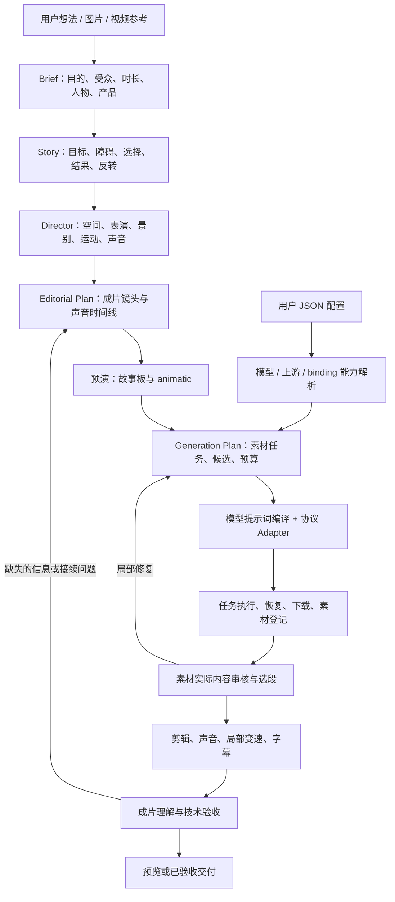

# VideoCreate v3：质量审计、开发架构与完整开发清单

日期：2026-11-02（Asia/Shanghai）  
目标仓库：https://github.com/1582345746/VideoCreate.git  
审计基线：`da3e01c022e99697b080a67ce9e2d20674dfeba2`  
本文状态：v3 本地核心已实现并迁移安装；未勾选项为后续增强或真实模型质量验收。勾选表示代码与对应本地证据成立，不表示模型输出已达到电影质量。详见 [实施与验收](v3-implementation-and-acceptance.zh-CN.md)。

## 1. 核心判断

可以重构，而且值得重构。当前系统已经具有可用的生成和恢复基础，但导演、表演、剪辑、内容验收没有形成可靠闭环。升级模型可能改善单镜头表现，不能补回缺失的故事信息，也不能自动决定何时切特写、何时留反应、怎样让产品功能成为剧情的原因。

VideoCreate 的目标应当是：**把一个想法转成能看懂、有表演、有镜头语言、可修改、可追溯的视频；模型和上游是可替换的执行资源。**

这次质量差有三层原因：

1. **创作和执行问题，证据充分。** 一镜承担过多事件；表演、视线等字段为空；镜头角色有错标；缺少独立剪辑计划；关键因果主要存在于文字剧本。
2. **技能实现和验收问题，代码可复现。** 喜剧工作流绕过事件流门禁；结构分仍可变成 `narrative_pass=true`；状态理由只查非空；静态抽帧不足以证明动态表演合格。
3. **模型/渠道能力问题，尚需对照实验。** 原生对白、人物动作、车辆运动和镜头服从度有生成不确定性，但本次没有同条件的 Grok/Seedance、Sub2API/NewAPI 对照，不能把责任全部归给某个模型或断言换上游就会变好。

首先纠正上一轮交付结论：我此前把技术/结构检查说成“剧情、画面、连续性通过”，证据不够；补 `state_change_reason` 只改变元数据检查，不会改善成片。最后交付画面也仍有徽标。本次不再沿用那些审核结论作为质量证明。

## 2. 本次审计范围与证据

### 2.1 已实际检查

- 本地 29 个 Python 运行脚本，共约 19,118 行；核心入口 `grok_video_studio.py` 为 6,951 行。
- 安装器、发行脚本、CI、技能说明、配置保存、上游路由、协议适配、导演规则、提示词编译、事件流、内容回执和 FFmpeg 编辑路径。
- 本次《孔明借车东风》的 `project.json`、`state.json`、保存的实际提示词版本，以及每镜头起、中、末共 15 张审阅帧。
- 直接从 `final.mp4` 提取并查看约 7.56 秒、17.55 秒的画面，防止把旧抽帧当成最终文件证据。
- 本地自动测试：`python -X utf8 -m unittest discover -s tests -p "test_*.py" -q`，**293 项通过，耗时约 286 秒**。此结果不是模型质量评测。
- 只读 `git ls-remote` 确认新仓库 URL 可访问，HEAD 与本地基线相同。本地 origin 目前仍为旧 URL。

### 2.2 证据边界

- 本轮没有完整听审或音视频理解工具调用，不能确认五句台词实际逐字内容、声音一致性和口型同步。
- 三帧抽样能揭示构图、物品和状态问题，不能量化全片流畅度、加速度和细微表情自然度。“僵硬”同时来自用户观看反馈；具体动态原因需要连续时序证据进一步定位。
- 未重新发起付费图像/视频任务，也未声称已经验证任何新的 Seedance 接口能力。
- 下文引用的模型名是当前项目/代码使用的标识；远端实际 ID、版本和能力以各上游配置和验证结果为准。

成片：`projects/three-kingdoms-smart-car-20261101/deliverables/final.mp4`  
SHA-256：`ed65caa56252cbde90253ec5ac4affaeda8632fc2bcdd09b7d5aa4b21d04ca32`

### 2.3 可定位的问题

| 编号 | 现象与证据 | 影响 | 开发方向 |
|---|---|---|---|
| F01 | 5/5 镜头的 `performance` 各字段为空；`lens`、`eyeline`、`screen_direction` 全为空 | “沉稳、克制”没有转化成可执行的眼神、身体、动作节奏 | 有动机的表演设计和空间调度；按镜头实际需要校验 |
| F02 | 时长为 5、5、5、5、6 秒；5/5 有对白；全部 `edit_in=0`、`edit_out=null`、`timeline_duration=null` | 接近按生成片段长度组织成片，缺乏信息和情绪驱动的剪辑 | 分开生成时长与保留时长；独立时间线 |
| F03 | 项目不存在 `edit-plan.json`，只有基础拼接交付 | 已有变速、转场、混音能力没有进入本次创作流程 | 生成后必须做有理由的选段与声音桥接，普通简单拼接仍可显式选择 |
| F04 | 第四镜 `shot_role=reaction`，提示词实际是 SUV 行驶、绕塌方、马车跟随、人物说话、到达前线 | 满足了“有反应镜头”的标签检查，没提供真正独立的反应覆盖；5 秒动作负荷过高 | 镜头功能和实拍覆盖核对；复杂事件拆镜 |
| F05 | `prompt_compiler`、`event_flow` 未配置，`narrative_contract_v2.required=false` | 新增的因果和内容审核机制未约束这个实际案例 | 按项目叙事意图选择合同，消除预设漏网 |
| F06 | `event_flow.py` 的必需名单不含 `comedy-scene`；复现返回 `reason=non-narrative workflow` | 有剧情的喜剧被当成无需事件链的工作流 | 喜剧/广告/人物故事也按叙事意图进入同一因果层 |
| F07 | `grok_video_studio.py` 约 4112 行以 audit/结构分产生 `narrative_pass`；正式内容回执强制条件依赖 scoped/event | 未看懂、未听审，也可能显示某些内容层通过 | 拆分结构合格与实际内容验收，未知保持未知 |
| F08 | 连续性比较是声明文本差异；`state_change_reason` 非空即可解释；本次第二、第三、第四镜理由仍错位 | 元数据可以“通过”，画面接续却未被证明 | 声明状态、观察状态、转场理由分别保存；差异必须引用画面证据 |
| F09 | 5 个保存的实际视频提示词均选 `compact`；full 为 6,463–6,669 字节，compact 为 2,366–2,571 字节 | 规划里写了很多，但模型收到的是压缩版；需明确保留/丢失了什么 | 本镜头局部编译、语义投影、编译追踪；不要默默删导演意图 |
| F10 | full 编译会注入整片目标/结果；历史题材包含 `no modern objects`，本片却需要现代 SUV | 设计存在未来剧情泄漏和题材规则冲突风险 | 历史背景与允许的穿越道具分开；镜头只收到当前可见事实 |
| F11 | 对 F10 的重要限定：这次实际 compact 不含那句 `no modern objects` | 不能把未发送的矛盾提示词说成此次质量差的确定原因 | 审计必须以实际 request snapshot 为准 |
| F12 | shot-003 标记 insert，但抽样画面以人脸、上半身和车窗为主，导航只占很小区域 | “为什么绕路有效”缺少可读的视觉证据 | 专门拍路障/导航改线/绕行动作；必要 UI 由后期精确制作 |
| F13 | final 约 7.56 秒，车头仍有明显浅色徽标形状；原审核备注称已清洁 | 后期遮挡和验收均漏掉实际残留 | 动态遮罩/跟踪、全保留区间复核；失败回执覆盖旧通过 |
| F14 | 默认每条片段抽 3 帧；音频能量和有音轨被技术检测，但不能证明正确台词 | 不足以验收动态动作、说话人和笑点 | 静帧证据、时序证据、声音证据分层 |
| F15 | `media_client.py` 与入口有全局 1–15 秒及固定分辨率枚举；`provider_contracts.py` 按上游类别声明能力 | 模型、具体渠道、协议版本的能力容易混同 | 能力绑定到“模型 × 上游实例 × 协议 × 操作” |
| F16 | Sub2API 客户端接受 `generate_audio` 参数但当前 JSON create 不发送该字段；其他 adapter 行为不同 | 用户的声音选择可能只是意图，未成为远端可控参数 | 显式标记 supported / model-default / unsupported / unknown；禁止静默忽略 |
| F17 | 293 测试通过，仍发现上述实际质量问题 | 测试保护了实现不变量，缺少成片验收集 | 新增内容基准、参考案例、盲评和失败样本回归 |
| F18 | 旧名称跨至少 44 个文本文件，涉及配置目录、环境变量、入口、安装器、包、CI | 简单改文件夹会破坏恢复、凭据发现和升级 | 有清单、有迁移器、有兼容边界的品牌迁移 |

## 3. 为什么看起来僵硬、缺少电影感、叙事不清

### 3.1 “克制”不是“站着不动”

目前主要让模型保持人脸、服装、羽扇稳定，再同时完成对白和很多动作。“自然、克制、电影级”是审美意图，不是表演调度。它容易得到同一种站姿、同一种说话节奏、同一种轻推镜头。

应当把身份锁和运动自由度分开。可以锁脸、冠帽、衣料和年龄感，但仍允许重心变化、眼神先动、手势延迟、羽扇短暂停顿、衣袖因转身摆动。每镜只选对当前情绪有帮助的细节，不要堆十条微动作。

例如“听到车会认路后的反应”可以写成：目光从斥候移到车窗；扇子停半拍；嘴角准备说话又收住；身体稍前倾想确认。它同时告诉模型**什么引发反应、反应发生在哪里、为什么改变**。

### 3.2 镜头标签不能替代构图

本片不是完全没有近景：第四镜的中间抽帧就明显靠近人物。问题是近景没有被独立设计为叙事工具，甚至可能挤在一条多事件片段里。

特写需要一个明确的信息目标：让观众看见堵住道路的石块、看清导航改线、捕捉军师意识到士兵在拜汽车的表情。单纯把镜头推近脸，或者在 720p 大景上粗暴裁切，不会自动增加故事信息。

### 3.3 慢镜头不是整段减速

现有编辑器已经支持 `setpts`/`atempo` 逐片段变速，但本项目没有使用。慢镜头还需要动作本身有可观察的变化和明确的强调对象。

- **慢推镜头**：相机缓慢接近人物，现场动作/对白仍为实时。
- **生成时的缓动作**：让模型表现较慢的动作，并不代表真正高帧率拍摄。
- **后期慢放**：改变播放速率。24 fps 源素材 0.5 倍播放只有约 12 个独特源帧/秒，改成 30 fps 容器只是重复/重采样，不会凭空增加动作细节。
- **光流补帧**：可选修复工具，可能产生手指、胡须、轮毂伪影；不应默认应用到说话脸部。
- **真实较高源帧率**：只有所选模型和当前上游确实支持并实际输出时才能使用，不能通过请求里随意加 fps 假装支持。

优先用于车轮压水、羽扇停顿、眼神反应等短暂强调；对白保持自然速度，声音可以作为独立轨道持续。

### 3.4 故事因果没有真正拍出来

当前设定“塌方 → SUV 导航 → 绕行 → 送粮 → 士兵向车行礼”在文字上成立。但观众还需要看见：

1. 原路确实不能走，而非只有人说了一句。
2. SUV 给出了古人缺少的信息，车的价值为何不可替代。
3. 车队确实使用了这条路线，且结果有所改变。
4. 士兵是在拜汽车，军师对此产生了什么期待落差。

如果删掉产品，故事仍然只是“换条路把粮送到了”，现代产品与剧情的结合就不够强。产品功能必须触发角色的选择或反转，不能只作为好看的摆件。

穿越故事可以不解释汽车的技术来源，但必须让观众快速识别“古人第一次遇到能认路的车”这个前提。幽默的铺垫、误解和结果要在画面中可定位。

### 3.5 规则越来越多，执行结果没有变得更可信

已有 scoped prompts、event reducer、hash receipts、editing 等好设计，但它们分布在可选路径中；旧路径仍可绕过部分机制。不能继续靠给 SKILL.md 再加十条“必须电影级”解决。

重构要让默认产品流程使用这些能力，并把“声明了”与“实际观察到”作为不同数据；仍保留单镜头、静态产品展示、慢节奏电影等合法例外。

## 4. 新架构的边界与开发原则

1. 保留已有有价值的模块，逐段替换入口和数据边界；不重写所有 FFmpeg 和网络逻辑。
2. 新产品统一称 **VideoCreate**；Grok、Seedance 继续是模型名称。
3. 日常用户只有一个主要编辑入口：`videocreate.config.json`。复杂能力资料由程序维护、按需展开。
4. 不承诺填任意模型字符串就能使用任意 API。已有协议内的新增实例/别名可配置；新的协议或参考方式需要 adapter 实现。
5. 模型选择、上游选择、协议选择彼此独立；具体组合必须知道其能力证据级别。
6. 人物表演与节奏是规划工作；参数和后期只是实现手段。
7. 调用 API 的一个 task，不必等于成片的一个镜头；一个事件也不必等于一个 task。
8. 节奏按创作模式控制：喜剧、快对白、悬疑、慢电影、产品演示不共享一个强制“每镜短于 3.5 秒”的规定。
9. 已知 task 永远绑定原上游恢复；提交结果未知仍是未知。“查不到记录”不能改写成已确定未创建。
10. 自动测试与视觉验收分开；新增审核层不能只是新的字符串打勾。

## 5. 总体开发框架



采用本地 Python 模块化单体、CLI 和 FFmpeg；不为了重构引入常驻 Web 服务或微服务。Docker/TTS/口型等保持可选。

| 模块 | 输入/输出 | 明确职责 |
|---|---|---|
| `config` | 用户 JSON → 经过校验的配置 | 版本、默认项、路径、秘密引用、诊断、迁移 |
| `catalog` | model/upstream/binding → 有效能力 | 模型家族、远端名、实例、参数限制、证据状态 |
| `planning` | brief → story/director/editorial/generation plan | 创作逻辑、动作负荷、镜头覆盖、预演、预算 |
| `assets` | 原始参考 → identity/scene/prop registry | 来源、角色/道具引用、画面哈希、实际使用关系 |
| `prompts` | 单任务合同 → 模型提示词 | 本镜头信息投影、冲突检查、模型家族优化、字节追踪 |
| `adapters` | 标准请求 ↔ 上游协议 | 上传、序列化、提交、查询、取消、取结果；不写剧情 |
| `runtime` | generation plan → jobs/attempts/artifacts | 短锁、预算预留、未知提交、轮询、恢复、依赖失效 |
| `editorial` | 选段与音轨 → 时间线 | J/L cut、反应覆盖、重排、变速、字幕、响度 |
| `qa` | 实际素材与成片 → findings/receipts | 技术、叙事、动作、身份、空间、声音、必要 UI |
| `cli` | 命令 → 模块服务 | 参数处理和结果展示，不承载业务大函数 |
| `migrations` | v1/v2 → v3 兼容状态 | 名称、路径、配置、项目、凭据和恢复记录迁移 |

## 6. 模型、上游和 Adapter 应如何解耦

### 6.1 五个概念

| 概念 | 例子 | 不应混淆的事情 |
|---|---|---|
| 模型家族 `family` | grok / seedance | 决定可尝试的提示策略，不等于某 API 协议 |
| 本地模型 ID `model_id` | `grok-imagine-video-1.5` | 用于稳定选择；可与远端名称不同 |
| 上游实例 `upstream_id` | `aivalux-sub2api`、`backup-newapi` | 是具体地址/账户；同类上游可配置多个 |
| 协议适配器 `adapter_id` | `sub2api-json-v1`、`newapi-json-v1`、`newapi-multipart-v1` | 决定 endpoint、body、响应解析；平台名字不能自动推断协议 |
| 绑定 `binding_id` | 某模型在某实例通过某协议执行某操作 | 远端名、参考限制、音频、时长、费用和验证证据落在这里 |

必须支持以下四格，且逐格验证：

| 模型 | Sub2API 实例 | NewAPI 实例 |
|---|---|---|
| Grok | binding A | binding B |
| Seedance | binding C | binding D |

同一个 NewAPI 实例给 Grok 暴露 multipart、给 Seedance 暴露 JSON，也是合法配置。因此 adapter 放在 binding 上，实例只保存地址、鉴权和通用网络设置。

### 6.2 能力合同

每条 binding 按操作（T2V、I2V、图像编辑等）保存能力描述：

- 时长枚举/范围/步长，以及“720p 最长多少秒”等联动约束。
- 分辨率、画幅、实际源帧率能力、尺寸与画幅的冲突处理。
- 首帧/尾帧/身份参考/普通参考的语义，参考数量、MIME、大小、上传或 data URL。
- 声音开关是否真正可控，是否只能遵循模型默认；原生对白、外部音频引用分别声明。
- 视频延长、视频编辑、首尾帧、多图、motion reference 等均为独立能力；没有证据时是 unknown。
- 提示长度的字节/字符限制，不把旧 4096 字节上限当成所有模型的永久上限。
- 上传、异步任务、幂等键、查询、内容下载、取消、费用单位、并发/速率限制。
- `verification_level`：`configured`、`catalog_seen`、`contract_checked`、`smoke_passed`、`quality_evaluated`，每级有时间、配置指纹、证据引用。

有效能力由模型、实例/渠道限制、adapter 可表达范围和 binding 验证共同决定。未知不能当作支持；模型出现在 `/models` 也不能自动升级为可生成。

### 6.3 路由与恢复

- 明确固定 Sub2API/NewAPI 时，严格固定。
- 自动策略只在用户选定模型的候选 binding 间切换；跨模型重规划是另一项明确配置，默认关闭。
- 首次提交前解析并固化 `binding_snapshot`：实例 URL 指纹、adapter 版本、model/remote_model、能力版本、请求参数、凭据引用 ID。凭据值不进入状态。
- 超时、502、成功但没有 task ID、写入结果前崩溃，均可能是 `submission_unknown`。
- HTTP 429/404 等是否证明“未创建”，应由该协议合同和响应证据判断，不能全局推断。
- 终态失败后的新 create 属于新尝试，受预算和已有授权限制；读取重试与创建重试分离。
- 有 task ID 后只到原实例查询和下载；配置变更/地址删除不能使旧任务转投另一实例。
- 无幂等或查询凭证时不能保证严格 exactly-once；保留未知状态与人工核查路径，不能伪造确定性。
- 健康、成本和质量是不同维度。HTTP 200 不等于动作好，快渠道不一定适合表情特写。

### 6.4 Adapter 的最小接口

```python
class VideoAdapter(Protocol):
    def validate(self, request, capability_snapshot) -> ValidationReport: ...
    def prepare_references(self, references) -> PreparedReferences: ...
    def build_request(self, request) -> PreparedRequest: ...
    def submit(self, prepared_request, attempt_context) -> SubmissionResult: ...
    def get_task(self, task_handle) -> TaskStatus: ...
    def fetch_result(self, task_handle, destination) -> ArtifactSet: ...
    def cancel(self, task_handle) -> CancelResult: ...
```

`cancel` 可返回 unsupported；取消本地轮询不代表远端任务停止或不再计费。Adapter 不自行决定换模型、改剧本或重建任务。

新增同协议模型：配置绑定与能力资料即可。新增协议：开发 adapter 和合同测试。新增特殊创作能力：同时增加 planning/compiler 映射，不能只有请求字段。

## 7. 单个 JSON 用户配置与首次安装

配套草案：[videocreate.config.example.json](design/videocreate.config.example.json)。示例含 Grok/Seedance × Sub2API/NewAPI 四个绑定，另设独立图片服务绑定。所有地址为占位，密钥为空，无付费操作。

### 7.1 文件位置与用户体验

- Windows 默认：`%LOCALAPPDATA%/VideoCreate/videocreate.config.json`。
- macOS/Linux 默认：XDG 配置目录下的 `VideoCreate/videocreate.config.json`；没有 XDG 时使用 `~/.config/VideoCreate/`。
- 可通过 `VIDEOCREATE_CONFIG_DIR` 或 `--config` 指定位置。
- 仓库只保留 `.example.json` 与 schema；用户实际文件留在安装包之外，升级不覆盖。
- 用户可以直接在这个 JSON 里填写 `base_url`、`api_key`、远端模型名和路由，无需再把密钥发到聊天。
- 高级用户可把 `auth.api_key` 改成互斥的 `secret_ref` 或 `env`；现有 DPAPI 凭据自动迁移为引用，不要求重新填写。
- 日常简单配置只需改实例和绑定；复杂能力 profile 由安装包/本地探测记录管理，同文件可用 override。

配置文件含真实 `api_key` 时属于本机私有配置：运行程序按字段读入，诊断/错误/日志统一脱敏；不复制到项目、报告、发布包或 Git。用户直接编辑 JSON 是被支持的正常路径，不强迫用户改用命令行密钥输入。

### 7.2 拟议首次安装流程

1. 安装 `videocreate` 技能，创建单一用户配置与可供编辑器补全的 schema。
2. Codex 告诉用户配置文件的准确位置，能打开时直接打开；简短说明必填项。
3. 用户填写 URL、Key、remote model，选择启用的绑定与默认模型。可先只配置一个模型和一个上游。
4. `videocreate config validate` 离线验证 JSON、必填字段、引用关系、互斥项、重复 ID、路由环、参数冲突；不给网络发 create。
5. `videocreate doctor --read-only` 检查本地依赖和已配置的只读模型目录。无模型目录的服务可按已核实合同配置，不强行要求 `/models`。
6. 输出“可用 / 待配置 / 合同未验证 / 目录已见 / 受控样片已验证”的具体状态。
7. 用户实际发起生成时，在已有授权和预算范围内完成首次小样；不每次重复询问同样授权。若费用/调用额度没有边界，先给可审阅的最小请求计划。

安装阶段不隐式生成视频、不安装可选 TTS/口型模型。首次验证结果与 generation acceptance 分开保存。

### 7.3 Schema 与配置规则

- `schema_version` 有明确升级路径，JSON 标准格式，帮助文本放 schema description，不插入非法注释。
- 未知字段默认报错，扩展只能放声明过的 `adapter_options`/`provider_parameters`；不得默默忽略拼写错误。
- model ID、binding ID、upstream ID 分开引用；`remote_model` 精确保留大小写和供应商别名。
- 地址只规范化一次；定义 base_url 是否已含 `/v1`，由 adapter 统一拼接，禁止 `/v1/v1`。
- 配置优先级：明确 CLI 覆盖 > 项目/镜头显式值 > 用户配置 > 内置默认；已经提交任务的 snapshot 优先于这些可变项。
- 两个凭据来源同时配置须报冲突；打印有效配置时永远脱敏。
- `max_total=null` 表示没有硬金额上限，而非 0 元或无限授权；仍有请求数上限和既有任务授权边界。

## 8. 数据结构：把创作、生成和编辑分开

不要求用户手工维护许多文件。对外由 Codex 维护一个项目入口，内部按责任保存可检查的文件：

```text
project/
  project.json                 标题、意图、schema、默认路由、引用文件
  brief.json                   受众、类型、节奏、产品功能、交付目标
  story.json                   事件因果图、观众信息、反转
  director.json                场景空间、表演、镜头覆盖
  generation-plan.json         素材任务、模型绑定、变体、费用与依赖
  timeline.json                成片镜头片段、音轨、变速、字幕
  assets/                      参考、身份、场景、道具及来源清单
  jobs/<job_id>/                request snapshot、attempts、task handle、结果
  reviews/                     绑定素材哈希/时间区间的观察和决定
  deliverables/                preview、final、manifest
  state.json                   各阶段摘要，供 CLI 恢复和用户阅读
```

四种 ID 必须分开：`beat_id` 是故事事件，`shot_id` 是镜头覆盖，`job_id` 是生成任务，`clip_id` 是素材；`timeline_segment_id` 指成片中的使用区间。同一 clip 可以在时间线有多个区间；多个候选 clip 可以服务同一个 shot。

时间轴使用明确 timebase/有理数帧率和半开区间。帧率转换、速度变化、音轨偏移均在 source → timeline 映射中记录，不能继续按“每镜计划 5 秒”累加对白时间，忽略源片实际多出来的几十毫秒。

依赖失效按内容拆分：改字幕颜色只重渲染字幕；改末镜台词只影响末镜声音/口型和下游合成；改身份参考影响相关视觉任务；改标题不重新创建视频任务。审核回执绑定相关合同摘要和实际字节，避免整个 project 的非内容改动让所有审批失效。

## 9. 导演、表演和产品叙事系统

### 9.1 Story 层

输出观众能够复述的一句话：谁要做什么、为什么受阻、做了什么选择、结果如何。

每个事件声明 `requires`、`effects`、`audience_learns`、`visible_evidence_needed`。画外对白可传信息，但关键产品作用优先有可见结果。反应覆盖可以不产生新事件；不能逼每个特写编造状态变化。

“历史人物 × 产品”的模板只提供机制：人物原有办法受挫 → 产品功能提供不同办法 → 人物以古代认知解释 → 得到意外结果。它不限定手机、手表或汽车；普通产品也可以通过用途反转进入剧情。

### 9.2 Director 层

每镜选择需要的字段：

- 信息目标、叙事功能、景别/主体占比/可见区域。
- 镜位、视线、180 度轴线、前后景、屏幕运动方向。
- 相机运动与主体运动分别描述，给一个主导运动。
- 表演：触发 → 注意力变化 → 可见响应 → 当前决定；脸、目光、身体、手部只写必要部位。
- 接触关系：谁抓着什么、车门是否开启、手是否在窗内、车轮/马蹄是否接地。
- 入镜状态、可剪出口、下镜需要接住的信息或动作。
- 声音覆盖：画内/画外、对白延续、环境声和效果音。

不把所有字段一律设成必填；产品静物不需要演员视线。针对本次“人物表演+多镜叙事”才要求对应要素。

### 9.3 动作负荷与镜头规划

先由 Codex 拆出可见动作和状态变化，再由规则检查时长、并发对象、接触关系及镜头运动数量。自由文本关键词统计只作风险信号，不声称能准确算出动作难度。

“5 秒内 SUV 绕障碍、粮车跟随、诸葛亮说话、车队到前线”应拆为：路线/转向证据、车队通过、到达结果、人物反应。一次生成能多镜头时，也要能识别切点和分别验收；不能假定所有模型都只允许一个连续镜头。

### 9.4 身份与连续性

- 角色身份参考、服装参考、道具参考、场景地图分开；不要只存一个巨大 character bible。
- 人物稳定不是所有镜头固定正脸。为特写、侧面、反打提供同源身份参考与对应构图。
- 上一镜出口帧有助动作接续，但不是每个反打都应直接复制出口构图。身份、状态和镜位是不同约束。
- 同一场景尽量保持模型/视觉设定；确需混模型时逐镜对照色温、皮肤、材质、身份、运动风格，不能随机轮换。
- 车内/车外、坐下/站立、车门关闭/开启等状态变化必须被可见转场或合理省略镜头解释。

### 9.5 Prompt 编译

规划器看到全剧情；图像任务仅收到开场构图；视频任务收到当前事件、可见演员、运动、声音和必要连续性。

- 模型家族 profile 针对已实测效果调整表达顺序和冗余度，不虚构“电影参数”。
- 分开硬约束（身份、动作对象、事实）与可取舍风格词。
- 超长时先去重和删掉本镜无关内容；不足以表达时重写/拆任务，输出差异，不能悄悄删关键因果或对白。
- 记录实际送出的完整 prompt、参考哈希、请求格式和 compiler 版本，调试基于实际请求。
- UI/logo 规则改为“意外叠层禁止、剧情内必要元素显式允许”。用户要特斯拉/小鹏时可按授权创作意图描绘品牌；不能默认把一切产品标识当错误后再到处打码。
- 地图、手机页面等需要准确文字时使用可控后期合成；不要把叙事信息全部抽象掉，同时还期待观众看懂。

## 10. 预演、生成、剪辑和声音

### 10.1 先做能看懂的预演

付费视频前生成时间化故事板/animatic：关键帧或简图、拟定镜长、临时对白文字/已授权音频，明确哪些信息只存在于台词。预演是草稿，不冒充最终口型或音色。

在预算范围内先验证两个相邻的关键镜头：一个表演镜、一个产品动作/空间接续镜。能验证新流程再扩大到完整短片；不把通路不稳定的镜头复制成整季。

### 10.2 生成与候选

- 默认每个任务一条候选，关键动作/笑点可在已定预算内增加候选。
- 每次失败先分类：剧本信息缺失、镜头任务过载、身份漂移、动作物理错误、音频错误、接口失败。
- 只有局部问题就修复局部；不要每次全片重生。
- 原始返回文件保留只读；清洁、补帧、配音、裁切均产生新派生文件和 provenance。
- 技术参数成功后仍须检查内容；调用成功率和可用片段率分别统计。

### 10.3 编辑层

- 将生成素材挑选为有动机的片段；去掉无信息的开头等待、尾部站定和重复动作。
- 用动作切点、视线接续、道具细节、反应镜头组织节奏；转场效果不替代因果。
- 多音轨支持对白、环境、音效、音乐。J-cut 是声音先到下镜；L-cut 是上镜声音延续到下镜。
- 对白可覆盖听者、手、车轮和地图，不需要所有镜头都是人物对着画面说话。
- 保持动作片段可被独立变速，人物台词自然速度；速度变化需更新字幕/配音时间映射。
- 无额外图像细节时，720p 放大裁切不能假称真正特写；超过质量阈值需要专门生成。
- UI/屏幕图形作为可选合成层，需要角点/跟踪/遮挡验收，不把桌面悬浮 UI 硬贴到运动屏幕。

### 10.4 声音层

- 原生对白：最少依赖，但文本、声音、口型均要实际验收。
- 独立配音：能控制文字与统一音色，但需已授权的声音资源；不因为用户授权面容就自动推断有声音克隆权。
- 画外配音/旁白：适合产品细节与反应覆盖，不强行给每个镜头加嘴部运动。
- 口型同步：可选能力；仅对需要可见说话脸部的片段使用，防止为小片段安装整套服务。
- ASR 只核验文字信号，不能单独确认演员是谁或口型准确；VAD/响度不是“对白通过”。

## 11. 重新设计 QA：不把打勾当质量

建议至少拆为以下层，每层支持 `pass / fail / unverified / not_applicable`，附方法、范围、证据和资产哈希：

| 层 | 验收对象 | 不能拿什么代替 |
|---|---|---|
| structural | 配置、脚本、引用、时长、预算 | 不能叫“观众看懂” |
| technical | 解码、尺寸、帧率、音轨、黑帧、损坏 | 不能证明动作自然 |
| narrative | 实际目标、障碍、选择、结果、笑点 | 不能照抄故事合同 |
| performance_motion | 动作接触、速度变化、面部表演、静止尾巴 | 不能只看起中末 3 张图 |
| identity | 人物/服装/物品外形的跨镜稳定 | 不能仅凭文件名或提示词 |
| spatial_continuity | 方位、视线、动作出口入口、道具状态 | 不能只填 state_change_reason |
| audio | 实际文字、说话人、完整句、口型/声音时序 | 不能用有音轨和平均音量代替 |
| clean_frame | 意外字幕、UI、Logo、水印；显式允许项例外 | OCR 未检出不等于没有徽标 |
| editorial | 切点、节奏、声音桥、叙事信息顺序 | 技术拼接成功不等于剪辑完成 |

技术工具按动作/切点附近加密取样，必要时导出短视频循环供审核；冻结检测需考虑背景动而人物僵住的情况。光流/关键点等可选指标先作为风险分，不设置未经基准验证的万能阈值。

内容验收采用盲读成片：评审先看实际音视频，回答“谁要做什么、遇到什么、为什么用这个产品、结果怎样、笑在哪里”，再与计划比对。评审工具不可用时保留未验证，不伪造“已听审”。后续可配置独立多模态模型，但它是新增能力/费用，用户已有授权边界仍适用。

失败回执必须压过旧通过；修改/清洁后的素材重新绑定哈希。不要通过降低 clean-frame 要求来掩盖此次漏检。显示状态改为 `draft_preview`、`review_pending`、`accepted_delivery`，避免 `final.mp4` 文件名被误认为已经验收。

## 12. 本例的新分镜演示：让开发目标可观察

以下只是用于验收架构的导演方案，不是本轮已经生成的作品；镜头数不是所有视频的固定模板。

核心仍是：诸葛亮要按时送粮，导航解决绕行，士兵把功劳记给车。建议约 30 秒，先做预演再按实际对白和素材调整：

| 时间参考 | 画面功能 | 景别/动作 | 声音与因果 |
|---|---|---|---|
| 0–2.5s | 明确障碍 | 堵路落石与停住的粮车；一个空间明确的大景 | 斥候的报告可以先入画 |
| 2.5–5s | 军师受阻 | 诸葛亮看地图，羽扇由轻摇变停 | “原路走不通了。”；不重复演完整入帐 |
| 5–7s | 现代物品登场 | 车灯穿雾的产品近景，轮胎缓慢停住 | 电机声与马匹声形成时代反差 |
| 7–9s | 人物反应 | 军师眼神/羽扇短特写，轻前倾 | 可留半拍观察，不把沉默一律判错 |
| 9–12s | 解释关键功能 | 导航路线绕过障碍；必要路线图后期可控合成 | “它竟识得山路？”；人物可在画外 |
| 12–16s | 选择生效 | 同一方向的 SUV 和粮车拐入明确岔路 | “跟上。”；一个主要行驶动作 |
| 16–19s | 展示结果 | 粮袋被放下/粮车抵达；与开头停住的粮车呼应 | 环境声桥接，避免再挤一段行程 |
| 19–23s | 建立笑点指向 | 士兵绕过军师，对着车抱拳；同画面交代三者位置 | “多谢军师！”使误认清楚 |
| 23–27s | 克制反应与包袱 | 诸葛亮转眼，看车，再看手中的羽扇 | “来人，给它也配把羽扇。” |
| 27–30s | 可见笑点收尾 | 羽扇与车镜同框的简短结果镜 | 不再用台词解释笑话 |

慢镜头只可能用在车轮压水或羽扇停顿的短片段，不全片慢放。以上是 10 个时间线段，不必等于 10 个 API 请求；是否可从同一素材取不同区间/裁切，取决于实际分辨率和画面覆盖，不能预先承诺省多少调用。

## 13. 全量改名与兼容迁移

### 13.1 目标命名

| 对象 | 当前 | 目标 |
|---|---|---|
| 产品展示名 | Grok Video Studio | **VideoCreate** |
| GitHub 仓库 | GrokVideoSkill | VideoCreate（用户已修改） |
| 本地仓库目录 | `E:/MyFiles/ToolSkills/GrokVideoSkill` | `E:/MyFiles/ToolSkills/VideoCreate` |
| Skill 目录与 frontmatter.name | `grok-video-studio` | `videocreate` |
| Skill 调用 | `$grok-video-studio` | `$videocreate` |
| Python 包 | 散落在 scripts/，大量全局导入 | `videocreate` |
| CLI | `grok_video_studio.py` | `python -m videocreate` / `videocreate` |
| 无安装包执行入口 | 原大脚本 | `scripts/videocreate.py` 薄入口 |
| 通用工具模块 | `gvs_common.py` | 按 config/io/security/runtime 分拆 |
| 配置根目录 | `GrokVideoSkill` | `VideoCreate` |
| 配置文件 | 旧 config 结构 | `videocreate.config.json` |
| 环境变量 | `GVS_*` | `VIDEOCREATE_*` |
| 项目锁 | `.gvs-state.lock` | `.videocreate-state.lock`，迁移期需要统一锁语义 |
| UA、multipart 边界、临时前缀 | GrokVideoStudioSkill / GrokVideoSkill / gvs | VideoCreate / videocreate |
| 安装/发行包 | GrokVideoSkill-vX.zip | VideoCreate-vX.zip |
| CI、徽章、链接、测试入口 | 旧名称 | VideoCreate |

`grok-imagine-video-1.5`、`family=grok`、Seedance 远端模型名是业务标识，**不能做全局字符串替换**。已有历史任务、日志、内容哈希和用户故事标题也不能为了改品牌被重写。

### 13.2 迁移步骤

1. 盘点 tracked 文件和非版本目录：已安装 skill、配置、DPAPI、项目、参考图、模型缓存、可选服务路径、app workspace 绑定。
2. 新版本安装器先生成迁移计划和备份位置；不删除旧项目或模型。
3. 新代码读取 v3 配置；发现旧配置时解析旧字段并映射为 models/upstreams/bindings。
4. 同 Windows 用户读取旧 DPAPI，写入新秘密存储引用；验证可读取后再切换。保留迁移回滚记录，密钥不输出。
5. 项目 v1/v2 转换保留 request/task/attempt 身份、实际参数和素材哈希；不产生 create。
6. 新 Skill 安装为 `videocreate`；旧目录先归档为不自动发现的备份，避免两套同类技能同时触发。
7. 旧入口、旧环境变量仅在集中 legacy compatibility 模块接受一个明确兼容周期，提示迁移；不把旧品牌继续放到正常 UI。
8. 锁切换、原子状态写入和旧进程并存须测试，不能因两种锁名让两个进程同时提交。
9. 本地根目录移动在保存任务状态并退出依赖该目录的进程后，从已核实的父目录操作；更新工作区和所有显式绝对引用。原项目内部优先保持相对路径。
10. 同步 origin、README、badge、CI、install/build、文档、示例、OpenAI UI 元数据；发布包检查不包含旧活跃 skill。
11. 验证旧任务仍能恢复、新项目能初始化、回滚可用；最后清理兼容周期允许移除的旧入口。

本节保留迁移约束。实际本机迁移、兼容策略与验收结果见 [v3 实施与验收](v3-implementation-and-acceptance.zh-CN.md)。旧项目不机械转写创作合同，写入兼容迁移回执并继续保留原任务恢复。

## 14. 建议目录结构

```text
VideoCreate/
  README.md
  pyproject.toml
  install.ps1
  build-release.ps1
  videocreate/                         可独立安装的技能目录
    SKILL.md
    agents/openai.yaml
    scripts/videocreate.py             薄入口
    src/videocreate/
      __main__.py
      cli/
      config/
      catalog/
      planning/
      assets/
      prompts/
      adapters/
      runtime/
      editorial/
      qa/
      migrations/
    references/                       按任务读取，不把所有流程塞进 SKILL.md
    assets/config/videocreate.config.example.json
    assets/schemas/
    assets/model-profiles/
    assets/workflows/
  tests/
    unit/
    contracts/
    migrations/
    integration/
    content-fixtures/
  docs/
  projects/                           用户作品，仍不进入发行包
```

CLI 的包导入路径由 pyproject 或薄入口明确建立；不能复制一个依赖父仓库路径的半成品 skill。安装包须离开仓库后也能离线执行 version/config validate。

## 15. 完整开发任务清单

优先级：P0＝v3 核心验收必须完成；P1＝第一轮质量增强；P2＝明确后续扩展。每项完成均需对应产物和验收证据，不能仅修改说明文件。

### A. 基线与重构准备

- [x] A01：完成代码/成片样本审计，保留 F01–F18 证据与限制。
- [x] A02：运行现有测试，记录 293 项通过的基线。
- [x] A03：建立 config/catalog/adapters/planning/runtime/timeline/review 模块边界与依赖图；薄 CLI、导入无网络与无用户配置写入回归通过。
- [x] A04：保留旧失败素材与哈希；新回归覆盖喜剧叙事、空表演、过载反应、任意状态理由、静帧不足及失败优先。
- [x] A05：开发分支、pre-v3 源码备份、发行检查清单和回滚路径已建立。

### B. VideoCreate 品牌与迁移

- [x] B01：VideoCreate 活跃品牌/目录/frontmatter/入口/CI/脚本完成；旧名仅限兼容层与历史证据，发行无旧活跃技能。
- [x] B02：videocreate 包、薄 CLI、旧入口 shim 与 wheel 资源封装完成；包外独立运行通过。
- [x] B03：install/build/uninstall/repair 已更新；真实安装/保档位升级/卸载与升级失败回滚通过。
- [x] B04：v2 配置转换和本机 DPAPI 密文字节迁移完成；旧源保留，凭据未输出。
- [x] B05：v3 ledger/snapshot/锁/unknown/reconcile 完成；旧项目写兼容迁移回执，原任务与签名保持，不机械转写旧导演合同。
- [x] B06：本机技能安装和物理仓库迁至 VideoCreate；旧根仅为 junction，原项目/密文/成片哈希保持。
- [x] B07：单一版本来源、manifest、wheel/ZIP 与兼容期说明完成；均为 3.0.0.dev1。

### C. JSON 配置与首次使用

- [x] C01：实现用户配置 schema 与跨字段验证；非法字段/引用/协议组合被拒绝。
- [x] C02：实现 `config init/open/validate/show/import`；主要模型/上游配置为一个 JSON 文件。
- [x] C03：inline/env/DPAPI secret_ref、互斥验证、脱敏 show/attempt/error 完成；源码和发行包 Key 形态扫描通过。
- [x] C04：首次安装创建单一 JSON 并返回配置位置；未启用默认视频路由时 ready/doctor 报 setup_required，不生成。
- [x] C05：离线 validate 与显式 `doctor --read-only` 分离，二者均不创建媒体。
- [x] C06：config effective 展示配置/项目/job/显式绑定的值与来源；已知 task 继续按原快照恢复。
- [ ] C07〔P1〕：支持配置备份、版本迁移、编辑器补全与中文说明；验收：未知新版本不被旧程序破坏。

### D. 模型/上游/协议能力

- [x] D01：models/upstreams/bindings/routes 与四格模型/上游表示。
- [x] D02：binding operation 和 capability 条件限制在请求前校验。
- [x] D03：configured/catalog/contract/smoke/quality 独立哈希证据与失效检查完成；目录可见不升级为生成或质量通过。
- [x] D04：抽离三个视频 adapter wire paths；本地 payload fixture 覆盖各自字段。
- [x] D05：独立图片 binding/adapter/预算/引用已实现；切视频路由不改变图片实际 URL/Key/model，未知图像输出可无网络恢复。
- [x] D06：标准 prepared request、字段消费报告、参考哈希完成；未知参考阻断，Sub2API 音频明确为 model-default。
- [x] D07：精确 remote_model 与统一 URL 拼接完成；本地 fixture 验证大小写、特殊别名和防重复 /v1。
- [x] D08：默认排除 trace/request ID，仅协议显式列出字段才会接纳为 task ID。
- [ ] D09〔P1〕：支持经过验证的首尾帧、多图/视频/音频参考扩展；验收：未验证组合仍不可宣称支持。
- [ ] D10〔P1〕：能力/成本/延迟/质量的路由解释；验收：固定路由不被优化器覆盖。
- [ ] D11〔P2〕：在有需求时加入新的官方协议 adapter；验收：不需要改导演或时间线模块。

### E. 运行、预算与恢复

- [x] E01：新 v3 job 使用原子快照、attempt ledger 与提交前持久化。
- [x] E02：已知任务固定 model/remote ID/adapter/URL，凭据旋转不转移任务。
- [x] E03：网络读重试/内容候选/剧本重规划分别建模与记账。
- [x] E04：未知提交保持 hold；“查不到” receipt 不足以确认未接收。
- [x] E05：原子次数/价格预留、未知价格硬 cap、并发测试及凭上游账单证据 jobs settle 完成；未自动拉取远端账单。
- [x] E06：生成输入 hash 独立于标题/字幕/时间线；画幅/分辨率/参考字节变化要求本地 replan。
- [ ] E07〔P1〕：每实例限流、短锁并发、轮询抖动、断点下载；验收：一个慢任务不锁死其他状态读取。
- [x] E08：cancel-local 明确仅停止本地轮询；工具不可用保持 unverified，不声称远端已取消。

### F. 剧情与导演规划

- [x] F01：brief/story/director/generation-plan/timeline 分层可编辑；editorial 由独立 timeline segment 表示。
- [x] F02：按 narrative_intent/brief.intent 验证因果；comedy-scene/comedy-action 不再被自动排除叙事。
- [x] F03：产品 function→choice→visible_result 与 removal counterfactual 验证完成；选择/结果指向实际 beat。
- [x] F04：每镜信息目标与关键视觉证据覆盖完成；内容通过另需实际视频盲答。
- [x] F05：表演 trigger/attention/visible_response/decision、视线/方向和接触字段实现并校验；空 performance 阻断。
- [x] F06：场景 map/axis、可见位置与 entry/exit state 进入当前镜提示词；状态变化需因果 beat 和证据镜。
- [x] F07：声明动作负荷超过 pace profile 时阻断/建议拆分。
- [x] F08：reaction 必须声明实际反应动作及覆盖，不能仅靠标签。
- [x] F09：喜剧/对话/悬疑/慢电影/产品展示/动作六种 pace profile；静默与有目的停顿不强套对白密度。
- [x] F10：零付费 HTML/文字卡 MP4 预演和 30 秒十段例子完成；真实视频小样另需实际生成与内容验收。

### G. 参考素材与模型提示词

- [x] G01：资产注册/哈希、独立图像 binding、job 参考与图片恢复完成；当前视频只支持 opening-frame 角色，多参考语义仍未知。
- [x] G02：仅当前 job shots 与可见资产投影；未来演员、结局与无关状态排除，编译 trace 可审阅。
- [x] G03：opening-frame 与 identity/prop/scene 区分；当前 adapter 不支持的参考角色明确阻断，先合成开场关键帧。
- [x] G04：现代产品允许例外、具体排除项与全局禁令冲突检查；按 binding 计 UTF-8 长度，不截断关键字段。
- [x] G05：编译 trace/hash/bytes/保留/排除范围齐备；超限报错不静默丢必需字段。
- [ ] G06〔P1〕：Grok/Seedance 独立模型 profile 与实测基准；验收：改进基于对照素材，而非假定能力。
- [ ] G07〔P1〕：identity drift 与物品形态变化的对照板；验收：不把不变站姿当唯一身份保持手段。

### H. 剪辑、慢镜头与声音

- [x] H01：source 半开区间与独立 timeline segment 完成；可选择 edit window，自动 ASR 切点另属后续增强。
- [x] H02：独立 dialogue/ambience/music/effect 自然速度音轨及 J/L 延迟覆盖完成；自动声音桥设计未实现。
- [x] H03：segment 局部速度、字幕 source/timeline 映射、音频独立轨；说话源强制不随视频降速。
- [x] H04：source fps、输出 fps、预计 unique source samples、插帧=none 逐段报告并测试。
- [x] H05：native/offscreen/independent-voice/ambience/mute 每镜策略完成；独立声音不再同时请求模型朗读，未验证声音仍需听审。
- [ ] H06〔P1〕：动态遮罩/必要屏幕图形合成；验收：本例 7.56s 徽标不再被漏过，遮罩不破坏主体。
- [ ] H07〔P1〕：对白和音量验收、响度、切点声音连续性；验收：不是仅凭有 AAC 音轨通过。
- [ ] H08〔P1〕：可选补帧/局部速度曲线和风险预览；验收：伪影明确展示，原片始终保留。
- [ ] H09〔P2〕：ChatCut/剪映等外部编辑交接维持可选；验收：原生 FFmpeg 流程独立完成核心交付。

### I. 内容审核与可解释质量

- [x] I01：结构 pass 只给 structural，不再由字段完整产生 narrative pass。
- [x] I02：narrative/motion/identity/spatial/audio/clean-frame/editorial 分层、路径/哈希/保留区间与方法约束完成。
- [x] I03：任意状态理由不放行；整段 clean-frame/motion 不能凭三张静帧通过，旧片徽标失败证据保留。
- [x] I04：素材字节、契约和保留区间绑定；同字节同 scope 失败优先，过期证据失效。
- [x] I05：final receipt 需实际盲答 goal/obstacle/choice/result 及适用产品/笑点字段。
- [x] I06：review_pending/rejected/accepted_delivery 与 unverified 区分。
- [ ] I07〔P1〕：动作/切点自适应取样与时序预览；验收：3 张静帧不再足以自动接受整个表演。
- [ ] I08〔P1〕：缺陷→局部修复策略→复验闭环；验收：不因一个问题重生全片。
- [ ] I09〔P1〕：统一“有效镜头率、每个合格镜头成本、盲评理解率”报告；验收：不给任意综合分伪装艺术质量。

### J. 测试与交付

- [x] J01：原 293 回归全保留并通过，另增 v3 专项测试。
- [ ] J02〔阶段性〕：四格协议的 create payload、task/trace、能力阻断已用本地 fixture；各 provider query/download 全矩阵待补。
- [x] J03：Windows 真实安装/升级/DPAPI/工作区迁移/回滚已测，XDG 路径与非 DPAPI 凭据单测通过；Linux/macOS 实机尚未执行。
- [x] J04：提交前持久化、unknown、task pin、并发预算、显式绑定不自动切备用与零付费故障测试完成。
- [x] J05：CLI import/validate/compile/plan preview 本地实现并带零网络/零付费声明；完整客户端 spy 覆盖待加。
- [ ] J06〔P1〕：在授权预算内做 Grok/Seedance × 两上游的小样实测；验收：报告模型名、能力、实际音视频、失败和费用，不能只看模型目录。
- [ ] J07〔P1〕：人物反应、手与物接触、车轮、转身、反打、产品改状态、喜剧反转的内容基准集。
- [ ] J08〔P1〕：旧流程与新流程同脚本/同参考/相近预算盲评；验收：看理解、自然度、连续性和成本，不仅看截图好看。
- [x] J09：wheel/ZIP 构建及包外 version/config/plan/preview/legacy 运行通过，安装升级卸载与发行脱敏扫描通过。
- [x] J10：中文安装配置/项目/恢复审核/实施验收说明完成；模板单 JSON 可运行受控离线样例，真实质量边界明确。

## 16. 开发顺序与里程碑

| 阶段 | 依赖 | 交付物 | 退出条件 |
|---|---|---|---|
| M0 审计/设计 | 无 | 本文、配置草案、失败样例、测试基线 | 当前问题和重构范围可审阅；本轮已完成 |
| M1 品牌/包边界/迁移 | M0 | VideoCreate 入口、迁移器、兼容层 | 本地完成；本机安装、凭据和物理目录迁移完成，旧路径为兼容链接 |
| M2 用户 JSON/模型绑定 | M1 | config/schema、四格 bindings、adapter 接口 | 本地完成；单 JSON、binding、协议与独立包测试通过，真实渠道合同保持待验证 |
| M3 导演/数据/预演 | M1–M2 | story/director/timeline/generation 分层、预演 | 规划与 30 秒例子通过；身份、视觉参考实测未验证 |
| M4 执行/剪辑/证据 | M2–M3 | 持久化任务、选段、多轨声音、局部变速 | 本地运行/剪辑/证据闭环完成；完整生产外观/音频验收待真实小样 |
| M5 内容质量小样 | M3–M4 | 两镜连续小样、四组合合同/质量报告 | 可用能力经实测，未测试项保持未知 |
| M6 完整样片/发布 | M5 | 完整新样片、盲评、迁移演练、发行包 | 内容与工程验收同时通过，剩余限制清楚 |

P0 任务覆盖核心闭环；P1 并非要全部堆到第一次重构才可试用，但完整质量发布必须完成适用的小样和内容验收。P2 不阻塞核心。

建议在 M1/M2 期间就用旧引擎验证新的分镜思路，尽早判断质量方向。模块设计不必等所有新功能完成才落地；也不要只有新目录树，没有能执行的中间版本。

## 17. 具体测试矩阵与质量验收方式

| 用例 | 预期结果 |
|---|---|
| Grok + Sub2API、Grok + NewAPI、Seedance + Sub2API、Seedance + NewAPI | 各自独立 binding；同一 canonical model 的 remote ID 可不同 |
| 同一个 NewAPI 对不同模型使用两种协议 | 请求体正确，无全局 adapter 错绑 |
| 720p 超过某渠道时长上限 | 提交前报绑定限制；不擅自降画质 |
| 502 / create timeout / 200 无 task ID | unknown，不自动再付费 create |
| task 已知但轮询 404 | 保持原任务，按渠道合同重查；不把 lookup 404 当创建未发生 |
| catalog 只显示模型名 | 只标 catalog_seen，不标已支持原生音频或多参考 |
| 固定 Sub2API 失败 | 不擅自切 NewAPI；已有明确备用授权才使用对应策略 |
| 新默认模型为 Seedance，旧任务为 Grok | 旧任务按原 Grok binding 恢复 |
| 图片上游与视频上游分开 | 改视频配置不改变生图请求 |
| 修改字幕/标题/末镜声音 | 按依赖仅重建必要产物，无无关生成 |
| 一个 reaction 标签配行车内容 | 内容层不能靠标签接受 |
| 填任意 state_change_reason | 不可覆盖画面空间矛盾 |
| 三张帧没文字但中间有徽标 | 静帧不足时未验证；实际看到残留则 fail |
| 0.5 倍播放 24 fps 源片 | 报告真实采样与补帧策略，音轨/字幕映射正确 |
| 无 ASR/听审能力 | audio=unverified，预览可用，交付不能冒充通过 |

内容基准至少包含：单人微反应、对话反打、手拿物品、车辆转向、移动角色、产品功能改变结果、喜剧误解/揭晓。不能仅以本例车/诸葛亮设计整个系统。

盲评先设项目目标：例如至少 4/5 位未看脚本的观察者能准确复述目标、障碍、产品作用和结果；这是拟议人工验收目标，**不是当前已达到的数据**。动作自然度、身份、笑点另行评分并保留分歧。样本数不足不能给“Seedance 全面优于 Grok”等结论。

比较时使用相同故事、参考、画幅、目标时长与相近调用预算；每个关键测试至少考虑多个输出的生成波动，预算内安排，记录好坏两类结果。固定 seed 只有模型/上游实际支持时才可用；相同 seed 也不保证跨服务一致。

## 18. 立即应该避免的做法

- 只把 `GrokVideoSkill` 全文替换成 VideoCreate，再宣称已完成架构重构。
- 继续在 6,951 行入口里增加 if/else 支持每个上游。
- 用更长的“电影级、真实、流畅、震撼”提示词替代表演/镜头设计。
- 每条 API 输出都整段放进成片，或者为了电影感全片慢放/加溶解。
- 凭配置里的 `true` 就宣称支持多图、首尾帧、原生音频。
- 给喜剧、静默、产品展示强制同一种对白密度和镜头数。
- 把审批字段补齐作为画面修复；把模型输出未达到计划的问题从报告中删掉。
- 把未经听审、未经内容检查的预览文件当作已验收最终作品。

本次设计的优先落点是：**先把验收说真、把因果拍清、把镜头拆对，再用模型/上游配置能力扩大可用的执行选择。**
